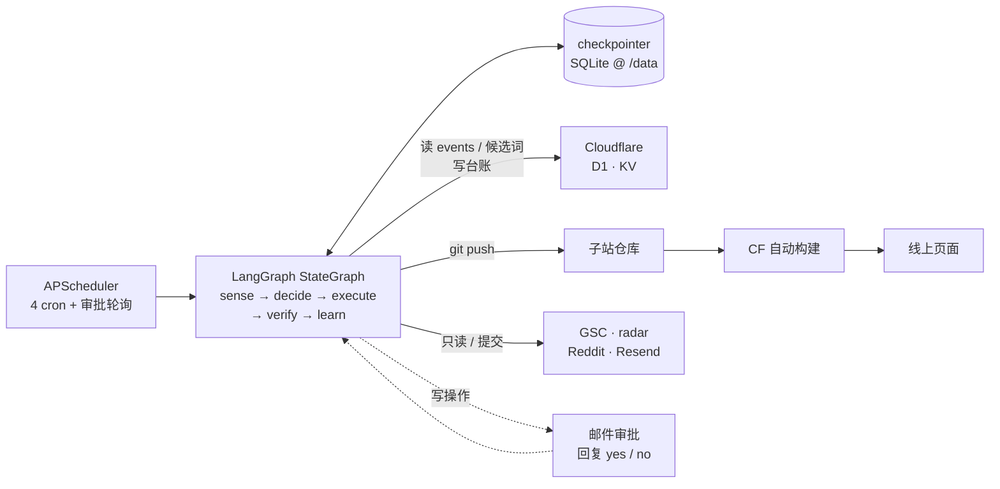

<!--
Copyright (c) 2026 lvyafei · https://toolara.dev
SPDX-License-Identifier: PolyForm-Noncommercial-1.0.0
-->

# site-agent

**给 [toolara.dev](https://toolara.dev) 站群做自动化运营的 Agent。**

Python · LangGraph · Cloudflare · Render · [PolyForm Noncommercial](LICENSE)

---

## 这是什么

[toolara.dev](https://toolara.dev) 是一个人维护的 **32 个免费英文在线工具站**（外加一个内部选题雷达）——每个子域一个产品，比如 `paypal.toolara.dev`（算 PayPal 手续费）、`sourdough.toolara.dev`（算酸种面包水合率）、`music.toolara.dev`（一句话生成一首歌）。全部跑在 Cloudflare Workers 上，流量几乎全靠 Google 自然搜索。

三十几个站意味着三十几份重复劳动：找选题、写页面、上线、提交收录、看数据、找外链、排推广。一个人做不完。

`site-agent` 就是来接手这些活的：它读站群自己的数据（埋点、选题雷达、Search Console），用 LLM 做判断，通过 `git push` 和 Cloudflare API 把决定落地，然后把结果回写成台账——形成一个能自己转的循环。

**它不是一个网站，也不是一个 SaaS。** 它是一台常驻后台的进程，没有对外端口，不承载任何用户流量。

> 用别人的站群跑不起来：它强依赖 toolara.dev 的目录结构、D1 表、站点映射。但如果你在维护类似的多站点矩阵，[`docs/02-architecture.md`](docs/02-architecture.md) 里的分层与决策记录可以直接借鉴。

---

## 解决什么问题

| 现状痛点 | Agent 怎么做 |
|---|---|
| 选题雷达能扫出值得做的词，但"值得做"到"页面上线"中间有 5 个手工步骤，词堆着没人动 | 读候选词 → 生成页面 → 推送上线 → 提交收录 → 7 天后回读效果 |
| 埋点天天在写 D1，没人每天看；信号弱、维度多，人肉看只会得出"大概还行" | 每天聚合 + LLM 结构化解读 → 日报邮件 + 可执行建议 |
| 外链机会靠手动刷 Reddit / Dev.to，看到合适的记下来就忘了 | 自动发现 → 打分 → 生成草稿 → 推给人审 |
| 推广没有排期，想到才发；平台红线靠记性 | 每周生成排期，红线由**代码校验器**把关而不是靠自觉 |

---

## 四个任务

| 任务 | 频率 | 自动化程度 | 做什么 |
|---|---|---|---|
| `gen-page` | 每天 08:10 | 写操作需人审 | 热词 → 内容页 → 上线 → GSC 提交 → 效果回流 |
| `daily-report` | 每天 09:00 | 全自动（纯读） | D1 + GSC → 解读 → 日报邮件 |
| `backlink` | 一/三/五 10:00 | 半自动 | 机会发现 + 评分 + 草稿；仅 Dev.to 走官方 API 自动发布 |
| `promo` | 周日 20:00 | 半自动 | 周排期 + 素材草稿，红线校验器拦违规 |

另有每 5 分钟一次的审批轮询（收邮件回复，续跑被挂起的任务）。

---

## 四条红线

写进代码，不写进 prompt。prompt 是概率性的，校验器是确定性的。

- **不向 Reddit / Hacker News / X 直接发帖**，只产出草稿等人发（账号是养号资产，一次批量操作就可能全废）
- **不做外链群发**（搜索引擎对批量外链的判定非常成熟，收益远小于风险）
- **不删数据**（D1 客户端在代码层拒绝 `DELETE`；对既有系统只新增，不改存量）
- **不消耗 Workers AI 额度**（账户级 10k neurons/天 留给绘图站，LLM 全走外部 API）

---

## 设计原则

1. **只有 `decide` 节点调 LLM。** 其余节点是纯函数，IO 全在 `tasks/` 与 `cf/`。换掉 LangGraph 时，业务代码零改动。
2. **checkpointer 只存图状态，D1 是唯一真相源。** 两套数据各管各的，不互相校验。
3. **不可逆的动作必须过人。** `interrupt()` 挂起 → 邮件审批 → 回复续跑。唯一的例外是有官方 API 的 Dev.to。

---

## 架构



三句话读完：

- **感知**读站群自己的数据（埋点、候选词、GSC），**决策**只在 `decide` 节点发生，**执行**只有两条路径——写内容（`git push`）和写台账（D1）。
- 状态全部落持久盘与 D1，**进程随时可被杀**，重启后从断点续跑。
- 写操作会挂起等人，**背景进程没有公网入口**，所以审批走邮件回复而不是点链接。

完整结构、数据流、六条架构决策（含代价）见 [`docs/02-architecture.md`](docs/02-architecture.md)。

---

## 当前状态

**实验阶段。** 文档与代码骨架已完成，单测通过；**尚未接入真实凭据，未部署**。

| 项 | 状态 |
|---|---|
| 文档（7 份） | 完成 |
| 代码骨架（图 + 5 节点 + 4 任务 + IO 层） | 完成 |
| 单测（红线校验器 + slug 安全） | 7/7 通过 |
| 真实环境联调 | 未开始（阶段 0） |
| 部署 | 未开始 |

进度与验收标准见 [`docs/05-roadmap.md`](docs/05-roadmap.md)。

---

## 快速开始

```bash
# 1. 依赖（白名单写在 pyproject.toml，多一个都不加）
uv sync                      # 首次会生成 uv.lock，请一并提交

# 2. 配置
cp .env.example .env         # 填 CF / GitHub / LLM / GSC / IMAP

# 3. 建表（在 tool-proxy 的 D1 库执行）
#    migrations/0001_agent_tables.sql

# 4. 单测（纯函数，不需要凭据）
uv run pytest -q test        # 应显示 7 passed

# 5. 启动调度器
uv run python -m site_agent.main
```

手动触发一次任务（不依赖 cron）：

```bash
uv run python -c "from site_agent.main import run_task; print(run_task('daily-report'))"
```

**建议先只跑 `daily-report`**——它纯读，零风险，且能验证 D1 / GSC / 邮件三条链路是否通。

部署与凭据清单见 [`docs/04-runbook.md`](docs/04-runbook.md)。有一个必须注意的点：**必须用 Render Starter + 1GB 持久盘**（$7/月），免费的临时磁盘会导致 checkpointer 丢失、人审流程静默失效。

---

## 文档

| 文档 | 回答什么 |
|---|---|
| [docs/01-background.md](docs/01-background.md) | toolara.dev 是什么？为什么需要这个 Agent？ |
| [docs/02-architecture.md](docs/02-architecture.md) | 系统怎么组成、怎么连、为什么这么连 |
| [docs/03-tech-design.md](docs/03-tech-design.md) | 技术栈、实现细节、四个任务的流程、踩过的坑 |
| [docs/04-runbook.md](docs/04-runbook.md) | 部署、日常操作、故障排查 |
| [docs/05-roadmap.md](docs/05-roadmap.md) | 分阶段计划与验收标准 |
| [docs/glossary.md](docs/glossary.md) | 名词解释 |
| [docs/README.md](docs/README.md) | 文档索引与编写约定 |

---

## 代码结构

```
src/site_agent/
├── main.py         调度入口（APScheduler）
├── graph.py        StateGraph 组装
├── state.py        OpsState / Action
├── approvals.py    IMAP 审批轮询
├── resume.py       Command(resume) + CLI
├── nodes/          sense · decide · execute · verify · learn
├── tasks/          gen_page · daily_report · backlink · promo
├── cf/             d1 · kv · deploy（会改变外部世界的只有这里）
├── llm/            gateway · breaker · prompts/
├── collectors/     gsc · reddit · radar
└── notify/         Resend
```

新增一类任务只改三处：`tasks/<name>.py`（实现 9 个约定符号）、`tasks/__init__.py`（注册）、`main.py`（挂 cron）。节点层与图完全不动。

---

## 成本

**约 $10-15/月**：Render Starter $7 + LLM $3-8。Cloudflare / GSC / Resend / Dev.to 均在免费额度内。一页内容的 LLM 成本不到 3 美分。

---

## 许可

**PolyForm Noncommercial License 1.0.0** —— 可自由用于学习、研究、修改、非商业项目；**禁止商业使用**，商用需书面授权（hello@toolara.dev）。

分发（含修改版）时需保留 `LICENSE` 与源码头部的 `Required Notice` 行。全文见 [LICENSE](LICENSE)。

Copyright (c) 2026 lvyafei · <https://toolara.dev>
