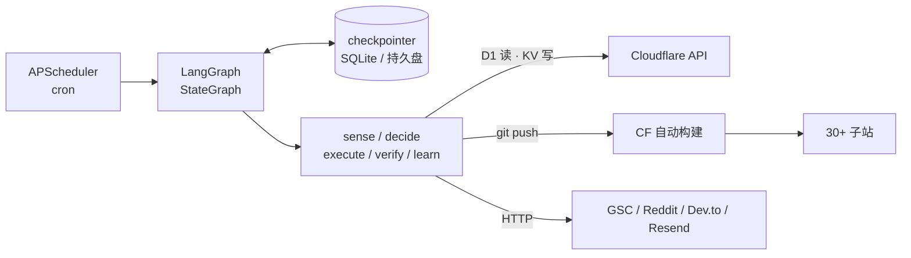

# site-agent

面向 [toolara.dev](https://toolara.dev) 站群（30+ Cloudflare Workers 子站）的自动化运营智能体。

用 **LangGraph** 把"感知 → 决策 → 执行 → 验证 → 反馈"做成显式状态图，跑在 **Render** 上；执行动作通过 **Cloudflare API** 和 **git push** 落到已有站点与流水线。设计思路与取舍见 [`docs/tech-design.md`](docs/tech-design.md)。

> **授权**：PolyForm Noncommercial License 1.0.0 —— 个人学习、研究、修改免费；**禁止商业使用**，商用需书面授权。详见 [LICENSE](LICENSE)。
> Copyright (c) 2026 lvyafei · https://toolara.dev

---

## 它能做什么

| 任务 | 频率 | 自动化程度 | 说明 |
|------|------|-----------|------|
| `gen-page` 热词 → 内容页 | 每天 08:10 | 写操作需人审 | 读 radar 候选词 → LLM 生成页面结构 → 模板渲染 → git push → CF 构建 → 线上校验 → GSC 提交 |
| `daily-report` 数据解读 | 每天 09:00 | 全自动（纯读） | D1 events + GSC → LLM 结构化解读 → 日报邮件；顺带回填已上线页面的 GSC 表现 |
| `backlink` 外链机会 | 周一/三/五 10:00 | 半自动 | 发现 + 评分 + 草稿；Dev.to 走官方 API 自动发布，其余人工发 |
| `promo` 推广排期 | 周日 20:00 | 半自动 | 生成周排期与素材草稿，红线由代码校验器把关 |

**不做的事**（硬编码红线，见 `docs/tech-design.md` 附录 B）：

- 不向 Reddit / Hacker News / X 直接发帖，只产出草稿等人审
- 不做外链群发
- 不消耗 Workers AI 额度（LLM 全走外部 API）
- 不删 D1 数据（`cf/d1.py` 直接拒绝 `DELETE`）

---

## 架构



- **只有 `decide` 节点调 LLM**，其余节点是纯函数 —— 换编排框架时业务代码零改动
- **checkpointer 只存图状态**，业务台账全部写 D1（唯一真相源）
- **写操作前 `interrupt()` 挂起**，等人回复审批邮件后续跑

---

## 快速开始

```bash
cd site-agent

# 1. 依赖（依赖白名单写在 pyproject.toml，不要随意加）
uv sync                     # 或用 venv：python -m venv .venv && pip install -e .
                            # 首次 sync 会生成 uv.lock，请一并提交

# 2. 配置
cp .env.example .env        # 填 CF / GitHub / LLM / GSC / IMAP

# 3. 建表（在 tool-proxy 的 D1 库执行）
#    migrations/0001_agent_tables.sql

# 4. 单测（纯函数，不需要凭据）
python -m pytest -q test

# 5. 启动调度器
python -m site_agent.main
```

手动触发一次任务：

```bash
python -c "from site_agent.main import run_task; print(run_task('daily-report'))"
```

---

## 人审流程

Background Worker 没有公网入口，所以审批走邮件：

1. `execute` 遇到 `risk=write` 且非白名单的动作 → 发信 `[site-agent] 待确认：<thread_id>`
2. 你直接回复 **yes** 或 **no**
3. 每 5 分钟 IMAP 轮询一次，收到回复后 `Command(resume=True)` 续跑
4. IMAP 不可用时兜底：

```bash
python -m site_agent.resume 'gen-page:2026-11-05' yes
```

Gmail 需开两步验证并生成**应用专用密码**（不是登录密码）。

---

## 环境变量

| 变量 | 用途 |
|------|------|
| `CF_ACCOUNT_ID` / `CF_API_TOKEN` | D1 + KV 操作（Token 只需 D1 Edit、Workers KV Storage Edit） |
| `D1_DATABASE_ID` / `KV_NAMESPACE_ID` | 目标库与命名空间 |
| `GITHUB_TOKEN` / `GH_ORG` | 子站仓库 push（细粒度 PAT，仅指定仓库，Contents: Read and write） |
| `GSC_SA_JSON` / `GSC_PROPERTY` | Search Console 服务账号（需在 GSC 加为资源所有者） |
| `LLM_API_KEY` / `LLM_BASE_URL` | OpenAI 兼容端点 |
| `RADAR_URL` / `RADAR_USER` / `RADAR_PASS` | 读 radar 候选词 |
| `RESEND_API_KEY` / `ADMIN_EMAIL` | 日报、告警、审批邮件 |
| `IMAP_HOST` / `IMAP_USER` / `IMAP_PASS` | 审批回复轮询 |
| `DEVTO_API_KEY` | Dev.to 自动发布（可选，缺失时该渠道动作标记 `blocked`，不影响其他任务） |
| `AGENT_STATE_DIR` | 状态目录，Render 上挂盘到 `/data` |

完整默认值见 [`.env.example`](.env.example)。

---

## 部署

`render.yaml` 已配好 **Background Worker**：

- **必须用 Starter + 1GB 持久盘**：免费实例文件系统是临时的，重启后 checkpointer 丢失，所有挂起的人审会静默失效
- 想零成本验证：Render 免费实例 + Neon 免费 Postgres，把 checkpointer 换成 `langgraph-checkpoint-postgres`（见文档 §5.3）
- git 仓库 clone 落在 `$AGENT_STATE_DIR/repos`，重启不必重拉

---

## 目录

```
src/site_agent/
├── main.py           调度器入口（5 个 cron）
├── approvals.py      IMAP 审批轮询
├── resume.py         Command(resume) 封装 + CLI
├── graph.py          StateGraph 组装
├── state.py          OpsState / Action 定义
├── nodes/            sense · decide · execute · verify · learn
├── cf/               d1 · kv · deploy（渲染 + git push + check run + 线上验证）
├── llm/              gateway（JSON 强制）· breaker（熔断）· prompts/
├── collectors/       gsc · reddit（只读）· radar
├── tasks/            gen_page · daily_report · backlink · promo
└── notify/mail.py    Resend
```

新增一个任务：在 `tasks/` 加一个模块（实现 `sense / build_user_prompt / parse / execute_action / verify / learn` + `NAME`、`LLM_PROFILE`、`PROMPT`），在 `tasks/__init__.py` 注册，在 `main.py` 挂一条 cron。节点层不用改。

---

## 开发约定

1. **依赖白名单**：`langgraph` + `langgraph-checkpoint-sqlite` + `openai` + `requests` + `apscheduler` + `google-api-python-client` + `google-auth`。不装 langchain 全家桶、playwright、celery、redis、sqlalchemy。
2. **节点是纯函数**：IO 全在 `cf/` 与 `tasks/`，节点只做编排。
3. **`execute_action` 必须幂等**：LangGraph 在 resume 时会从头重跑整个节点（`gen_page` 查 D1、`promo` 查当日排期、`backlink` 按 key 判重）。
4. **审批邮件只发一次**：用 KV 标记 `approval-sent:<key>`，否则每次 resume 都会重发。
5. **红线写进代码，不写进 prompt**：`tasks/promo.py` 的 `validate()` 是确定性的，prompt 是概率性的。
6. **锁版本**：`uv.lock` 进仓库，升级手动做并跑单测（LangGraph 迭代快）。

---

## 已知待办

- [ ] `events` 表列名按 tool-proxy 实际 schema 对齐（集中在 `tasks/daily_report.py` 的 `SQL_DAILY`）
- [ ] 站点映射 `config.SITES` 里的 host / repo 名核对
- [ ] radar 候选词接口路径核对（`collectors/radar.py`）
- [ ] 日报建议 → 下游任务自动转换（阶段 5）
- [ ] 外链 30 天存活复查（阶段 3）

---

## 成本

Render Starter $7/月 + LLM（mini 级）约 $3-8/月 ≈ **$10-15/月**；Cloudflare / GSC / Resend / Dev.to 均在免费额度内。

---

## License

**PolyForm Noncommercial License 1.0.0** —— 可自由学习与研究，禁止商业使用。
协议全文见 [`LICENSE`](LICENSE)，官方说明：<https://polyformproject.org/licenses/noncommercial/1.0.0>

Copyright (c) 2026 lvyafei · <https://toolara.dev>

### 可以做什么

- 阅读、下载、运行、复制本项目代码
- 修改、二次开发，用于个人学习、研究、实验、业余项目
- 用于教学、科研机构、非营利组织等非商业场景
- 把改动后的版本分享给别人（需同时带上本协议与署名）

### 不可以做什么

- 任何商业用途：包括但不限于拿去接私活交付、做成 SaaS 售卖、打包进商业产品、内部商业运营提效
- 去掉或替换版权声明、`Required Notice` 行、SPDX 标识后分发
- 用本项目申请专利或主张专利侵权

### 署名要求

依据协议 **Notices** 条款，你在分发本软件（含修改版）时，必须一并提供：

1. 本协议全文或上面那个官方 URL
2. 源码中每处 `Required Notice:` 开头的行，即：

```
Required Notice: Copyright (c) 2026 lvyafei · https://toolara.dev
```

源码文件头部已统一带上这三行，分发时请勿删除：

```python
# Copyright (c) 2026 lvyafei · https://toolara.dev
# SPDX-License-Identifier: PolyForm-Noncommercial-1.0.0
# 非商业授权：可学习、研究、修改、非商业使用；禁止商业使用。详见 LICENSE。
```

### 商业授权

需要商用请先取得书面授权：hello@toolara.dev

> 提示：本项目由个人（lvyafei）独立持有版权，与任何公司主体无关。署名行位于 `LICENSE` 首行及每个源码文件头部，如需变更持有者名称，这三处需同步修改。
