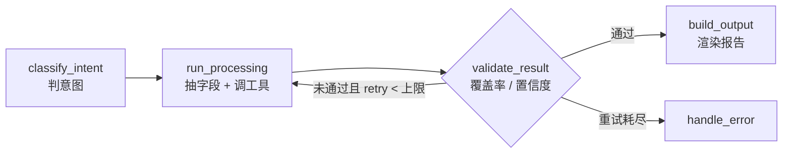

# 01 · 项目概览

> 三件事：这个 Agent 服务的对象（32 个子站组成的站群）、它一轮到底做什么、
> 以及它明确不做什么。

## 1. 一句话

`site-agent` 是 toolara.dev 站群的运营 Agent：给它一句运营请求，它跑完一轮
**判意图 → 抽字段 → 调工具取事实 → 校验 → 出报告**，需要时把结论写进 D1 台账。

它不做定时调度（外部 cron 调 `/run`），不做人工审批（写动作靠请求显式声明工具），
不做前端页面（页面在 `site-console`）。

## 2. 服务对象：32 个子站

站群是「一个关键词一个站」：每个子站一个独立仓库、一个独立 Cloudflare Worker
（静态资产 + `wrangler.toml`），统一入口 `tool-proxy` 按 Host 转发。

| 分类 | 数量 | 例子 | 成本特征 |
|---|---|---|---|
| AI 生成器 | 12 | `music`、`figurine`、`humanize`、`captions` | 有推理成本，按张/首限额 |
| 计算器与工具页 | 19 | `crcl`、`gfr`、`paypal`、`devtools`、`clocksgoback` | 纯前端，边际成本近零 |
| 季节活动页 | 1 | `blackfriday` | 每年 11 月自动切档期 |

站点清单是**配置**不是代码：`config/sites.json`（`SITES_FILE` 可覆盖），
`config.py:load_sites()` 负责装载与重名校验，字段含义见 `05-tools.md §4`。

流量结构决定了 Agent 的优先级：绝大多数访问来自 Google 自然搜索、英文为主、
会话以秒计；唯一直接收入来自 `music` 订阅。所以杠杆点是**「页面数量 × 收录率」**
与**「数据是否被读」**，不是页面设计，也不是买量。

## 3. 一轮运营做什么

一次 `POST /run` 就是一轮，五个节点串成一条流水线：

意图决定默认取哪些事实（`services/tool_service.py` 的 `INTENT_TOOLS`）：

| 意图 | 想回答的问题 | 默认工具（全部只读） |
|---|---|---|
| `select_pages` | 这周该写哪几个新页面？ | 热词候选 + 页面台账 + 历史复盘 |
| `plan_promo` | 下周推广怎么排？ | 上一版排期 + 页面台账 + 待消费事件 |
| `find_backlinks` | 哪里还有外链机会？ | 外链台账 + Reddit 讨论 + Dev.to 热门 |
| `review_metrics` | 哪个页面在涨、哪个掉了？ | D1 点击聚合 + GSC 表现 + 页面台账 |
| `general` | 泛问，没有明确指向 | 待消费事件 + 历史复盘 |

意图可由请求指定（`intent` 字段），否则交给 LLM 分类；两条路都落到同一张
`INTENT_TOOLS` 表上。

## 4. 事实从哪来

| 数据源 | 读什么 | 写什么 |
|---|---|---|
| Cloudflare D1 | 埋点 `events`、台账 `agent_*` | 台账写入（页面、报告、外链、事件、复盘） |
| Cloudflare KV | `agent:` 前缀的状态标记 | 状态标记（上次处理时间、已处理的键） |
| radar（`radar.<主域>`） | 候选热词与 `meta.updatedMs` | 只读 |
| Google Search Console | 点击 / 展示 / 排名（按 page） | 只读 |
| GitHub | check run（构建结果）、仓库文件 | `git push` 提交页面 |
| Reddit / Dev.to | 讨论与热门文章 | Dev.to 发文（`write`） |
| Resend | — | 运营通知邮件 |

## 5. 明确不做的事

| 不做 | 原因 |
|---|---|
| 定时调度 | 调度归外部 cron，Agent 只负责「一轮」，进程无状态 |
| 人工审批流程 | 写动作的闸门是「请求必须显式列出 write 工具」，系统不保存待审状态 |
| 前端 / 后台 | 页面与可视化在 `site-console`，这里只有 `/run` 与 `/health` |
| 站群入口转发 | 入口是 `tool-proxy` 的事，本站不参与任何线上请求转发 |
| 数据采集与判死 | radar 负责采集与 `verdict`，本站只读结果，不重复抓 |
| 向量库 / RAG | 没有跨轮记忆需求，台账就是记忆 |

## 6. 代价与风险（必须知道）

1. **`/run` 没有鉴权**：上线前必须在网关层加访问控制，不要直接暴露公网。
2. **写工具不可逆**：默认编排只调 `read` 工具；只有 `tools` 显式列出
   `git_push` / `publish_devto_article` 才会执行写。
3. **LLM 可缺席**：没有 `LLM_API_KEY` 时意图回退 `general`、字段抽取走本地正则，
   图仍能跑完，只是判断质量下降。
4. **外部凭据缺失即工具失败**：失败不会抛到 API，而是进 `tool_results` 的
   `ok=false`，由校验环节决定重试还是报错。

## 7. 为什么是这个形态

被考虑过并否掉的方向：

| 方案 | 为什么不做 |
|---|---|
| 大而全的运营 SaaS | 目标是自己一个站群，多租户与计费只会拖慢 |
| 把编排塞进 Workers | 无长驻进程、无持久化图状态；Workers AI 额度是账户级，出图站已占大头 |
| 纯脚本无 LLM | 字段抽取与数据解读写不出可维护的规则 |
| 全自动外链 / 全自动发帖 | 账号是长期资产，平台 ToS 与封号风险不能赌 |
| 现成 SEO 自动化工具 | 接不上自己的 D1 埋点、CF 构建流水线与 radar 打分 |

## 8. 读完这一篇，你应该能回答

- 这个项目在站群里处于什么位置？（判断与写入，不是入口、不是采集、不是控制台）
- 一轮运营的输入输出是什么？（一句请求 → 一份报告 + 台账写入）
- 写动作为什么不需要审批？（靠 `tools` 显式声明，风险由调用方承担）
- 加新站 / 新工具 / 新意图该改哪里？（`05-tools.md §4`、`02-architecture.md §7`）
