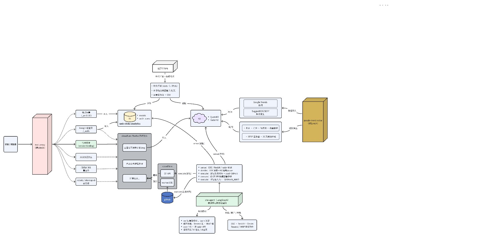
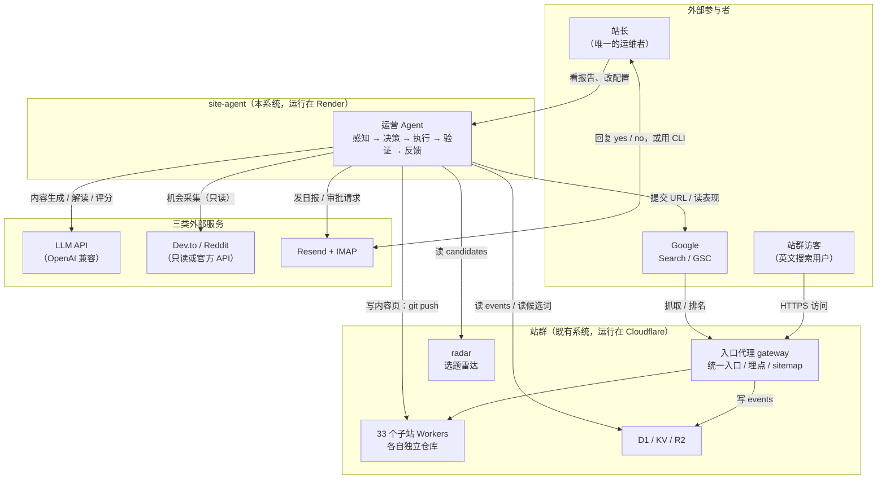
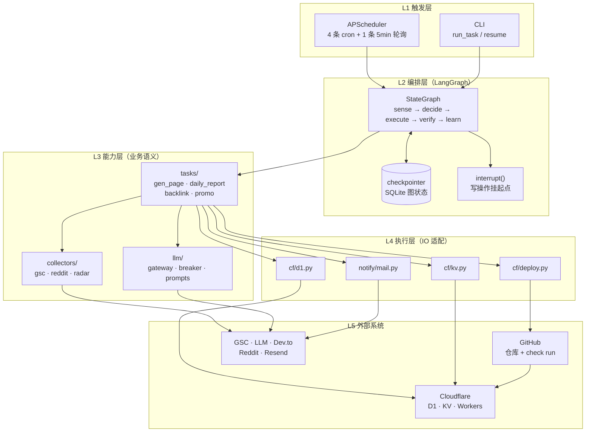
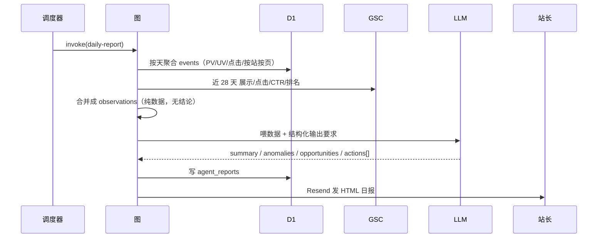
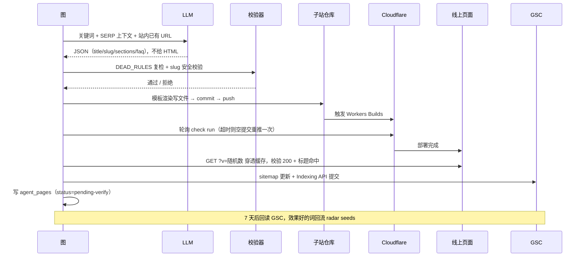
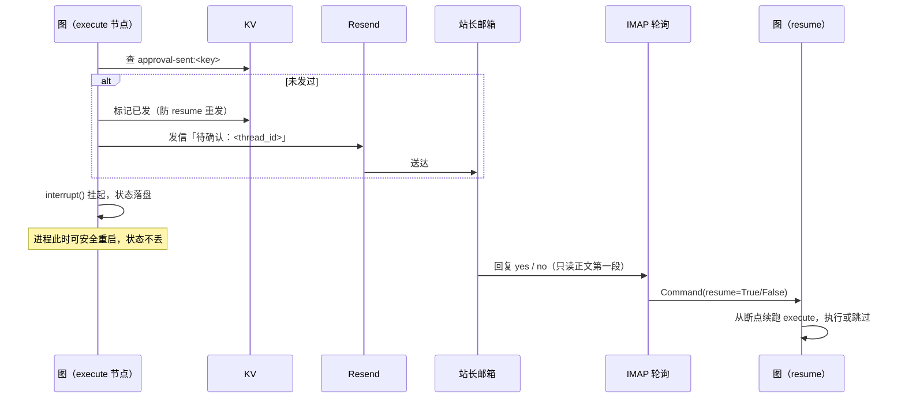
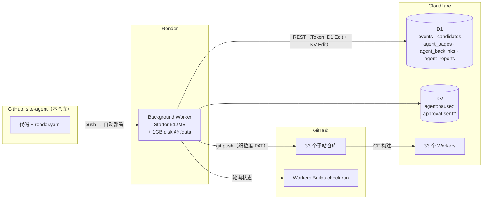

<!--
Copyright (c) 2026 lvyafei · https://toolara.dev
SPDX-License-Identifier: PolyForm-Noncommercial-1.0.0
-->

# 02 · 架构

> 本文回答：**系统由哪些部分组成、它们怎么连、为什么这么连、边界在哪。**
> 只讲结构与决策，不讲具体代码实现（见 [03-tech-design.md](03-tech-design.md)），不讲怎么部署（见 [04-runbook.md](04-runbook.md)）。
> 业务背景见 [01-background.md](01-background.md)。

---

## 1. 系统上下文

**系统全景图（手绘定稿，权威版）：**



图中要素速查（与后文各节一一对应）：

- **入口代理（粉色）**：所有流量的唯一入口，代理转发经 `service binding` 到 33 个子站 Worker；埋点 `/_ev` 与轻登录 `/_auth` 只写 D1（web-clicks-analytics 库的 `events` / `auth_users` 表）。
- **google-trend-radar（金色）**：数据采集（Google Trends 热词、Suggest 种子词、DDG SERP）→ 判死打分 → 候选池写 KV（RadarKV）；QuotaKV 记录额度用量；候选与统计数据供给 site-agent。
- **site-agent（绿色）**：LangGraph 五节点状态机，sense 读 GSC/KV/radar，decide 用 LLM 预案 + KV 规则缓冲，execute 写 GitHub / 通知 D1 / 状态栏 KV / DOMAIN_MAP，verify 更新 KV 状态、通知 D1；cron ×5 由 APScheduler 驱动；外部依赖 GSC / Reddit / Devto + Resend / IMAP 审批。
- **GitHub（蓝色圆柱）**：建站产物存储——agent push 代码，CF 构建部署到舰队；fleet ⇢ github 为 Worker 关联（部署目标）。
- **存储权限边界**：D1 = proxy 只写 / radar 只读 / agent 读写；KV 按命名空间分 RadarKV（radar）与 QuotaKV（agent 熔断、审批、额度）。
- **后台管理系统（人机界面）**：归属 radar，不进 agent——radar 已有鉴权、页面框架和 D1 只读通道，agent 的任务/状态表本身落 D1，radar 加一个「Agent」页（运行状态 / 任务历史 / 审批队列）即可看到 agent 数据，无需 agent 提供页面。执行追踪（LangSmith/Langfuse）是 SaaS，agent 只配环境变量接入，用它们自带的界面。

先看这个 Agent 在真实世界里跟谁打交道。



三条关键读法：

1. **Agent 不承载任何用户流量**。它不代理、不渲染、不对外提供服务。访客的请求完全不经过它——这决定了它可以是低频、可重启、可中断的。
2. **Agent 对站群只有两种写入**：`git push`（内容）和 `D1 INSERT/UPDATE`（台账）。没有第三种。
3. **人只在两个位置出现**：定期看报告、对写操作回 yes/no。除此之外全自动。

---

## 2. 分层架构

同一条链路上的五种角色，从上到下依赖，不能反向。



| 层 | 职责 | 允许做什么 | **不允许做什么** |
|---|---|---|---|
| L1 触发 | 决定"什么时候跑什么" | 定时、手动触发、审批轮询 | 不含任何业务判断 |
| L2 编排 | 决定"跑到哪一步、失败怎么办" | 状态流转、断点续跑、挂起等人、熔断 | 不直接发 HTTP、不拼 SQL、不写 prompt |
| L3 能力 | 决定"这一次要做什么" | 组装观测、调 LLM、解析成动作、业务校验 | 不关心调度与重试 |
| L4 执行 | 把动作变成真实副作用 | D1 读写、KV 读写、git 操作、发邮件 | 不含业务规则 |
| L5 外部 | 真实世界 | —— | 不可控，必须假设会失败 |

**这个分层的唯一目的是可替换性**：去掉 LangGraph 换成手写状态机 + APScheduler，只需重写 L2；把 SQLite checkpointer 换成 Postgres，只改 L2 的一个构造参数。L3 与 L4 一行不动。

---

## 3. 运行时视图

部署形态是**一个常驻进程**（Render Background Worker），没有 Web 服务、没有监听端口。

```
┌───────────────────────────── Render Background Worker（1 个实例）─────────────────────────────┐
│                                                                                              │
│  主线程：BlockingScheduler                                                                     │
│    ├─ 08:10 gen-page     ─┐                                                                  │
│    ├─ 09:00 daily-report  │  每次触发 → run_task(task_type)                                    │
│    ├─ 一三五 10:00 backlink┼→ 生成 thread_id = "<task>:<YYYY-MM-DD>"                           │
│    ├─ 周日 20:00 promo    │  → app.invoke(state, config={thread_id})                          │
│    └─ 每 5 min approvals ─┘     → 同步阻塞直到图跑完或被 interrupt 挂起                         │
│                                                                                              │
│  LangGraph 调用栈（同一线程内，串行）                                                          │
│    sense → decide → execute → verify → learn                                                  │
│      │        │         │                                                        │           │
│      │        │         └─ 遇 risk=write 且非白名单 → interrupt() → 落盘 → 抛回调度器          │
│      │        └─ 唯一 LLM 调用                                                                 │
│      └─ D1 聚合 / GSC / radar                                                                  │
│                                                                                              │
│  出站网络（全部 HTTPS / git，无入站）                                                          │
│    api.cloudflare.com · api.github.com · github.com(git)                                      │
│    oauth2.googleapis.com · searchconsole.googleapis.com · <llm 端点>                          │
│    api.resend.com · imap.gmail.com                                                            │
│                                                                                              │
│  持久盘 /data（1GB）                                                                           │
│    agent.sqlite（checkpointer）· repos/（各子站 clone）                                        │
└──────────────────────────────────────────────────────────────────────────────────────────────┘
```

运行时要点：

- **任务串行**：`BlockingScheduler` + 同步 `invoke`，同一时刻只有一个任务在跑。内存峰值 = 单任务峰值，这是 512MB 实例能跑起来的前提。
- **无入站端口**：所以审批不能"点链接"，只能走邮件回复（见 [03 §人审通道](03-tech-design.md)）。这是部署形态带来的一条硬约束，不是设计偷懒。
- **进程可随时被杀**：Render 会因部署、扩容、空闲回收重启实例。所有跨重启的状态都在 `/data/agent.sqlite` 与 D1 里，进程本身无状态。
- **git 工作副本常驻** `/data/repos`**：第一次 clone 后复用，重启不必重拉 33 个仓库。

---

## 4. 组件职责

模块级清单。**输入/输出**是接口契约，**失败行为**是容错设计的落点。

| 模块 | 职责 | 输入 | 输出 | 失败行为 |
|---|---|---|---|---|
| `config.py` | 环境变量 + 站点映射 + 上限常量 | env | `SITES` / `STATE_DIR` / `MAX_PAGES_PER_RUN` 等 | 缺必需变量 → 启动即 `SystemExit(1)` |
| `main.py` | 注册 cron、串行执行任务 | 无 | 日志 + `run_task` 返回值 | 单任务异常被吃掉，调度器继续（不能让一次失败拖垮进程） |
| `graph.py` | 组装并编译 StateGraph（单例） | 无 | 带 checkpointer 的 app | 编译失败 → 启动阶段暴露，不进入调度 |
| `state.py` | `OpsState` / `Action` 类型定义 | 无 | 类型 | — |
| `nodes/sense.py` | 熔断检查 + 分发到任务自己的 `sense()` | `task_type` | `observations` | 熔断中 → 抛 `BreakerPaused`，`run_task` 捕获后跳过 |
| `nodes/decide.py` | 唯一 LLM 调用点：拼 prompt → `json_call` → `parse()` | `observations` | `actions[]` | LLM 失败按重试策略退避；仍失败 → 计熔断 |
| `nodes/execute.py` | 幂等去重 → `interrupt()` → 调 `execute_action` | `actions[]` | `executed[]` | 单个动作失败记入 `executed`，不中断其余动作 |
| `nodes/verify.py` | 调任务自己的 `verify()`，判定成功/失败 | `executed[]` | `result` + 失败计数 | 连续失败计入熔断 |
| `nodes/learn.py` | 写台账、发通知 | `result` | D1 写入 + 邮件 | 写失败只记日志（不回滚已上线内容） |
| `tasks/*.py` | 四类业务的语义：怎么感知、怎么问、怎么解析、怎么执行 | `state` | 见各模块 | 由节点层兜底 |
| `llm/gateway.py` | 按任务 profile 调 LLM，强制 JSON 输出，记 token | prompt | `dict` | 重试 2 次；累计失败触发熔断 |
| `llm/breaker.py` | KV 熔断：连续失败 N 次暂停 M 分钟 | 事件 | KV 键 | KV 不可用 → **fail-open**（放行，不因监控挂掉业务） |
| `collectors/gsc.py` | 读展示/点击/排名，提交 Indexing | 日期范围 / URL | 结构化数据 | 无凭据 → 返回空并降级为"仅 D1 数据" |
| `collectors/reddit.py` | `search.json` 只读采集 | 关键词 | 帖子列表 | 被限流 → 空结果，不影响其他渠道 |
| `collectors/radar.py` | 读 radar 候选词 | 无 | `candidates` | radar 不可用 → 本日跳过 gen-page |
| `cf/d1.py` | D1 HTTP 客户端 | SQL + params | rows | **代码层拒绝 `DELETE`**；失败抛异常 |
| `cf/kv.py` | KV 读写，键前缀 `agent:` | key/value | 值 | 读失败返回 None（视作无标记） |
| `cf/deploy.py` | 渲染 → 写文件 → commit → push → 等 check run → 线上校验 | 生成页 + 站点配置 | bool | check run 超时 → 空提交重推一次；仍失败 → 返回 False 交 verify |
| `notify/mail.py` | Resend 发信 | 主题/HTML | 发信结果 | 缺 key → 只记日志，不阻塞主流程 |
| `approvals.py` | IMAP 轮询审批回复 | 未读邮件 | `resume(tid, bool)` | 连接失败 → 本轮跳过，下轮再试 |
| `resume.py` | `Command(resume=...)` 封装 + CLI | `thread_id` + 结论 | 续跑结果 | 无对应 thread → 记日志并忽略 |

一条贯穿全表的原则：**只有 `cf/d1.py` 和 `cf/deploy.py` 会改变外部世界**。其余模块要么只读，要么只影响自己的状态。想在代码审查时快速判断风险，看有没有调这两个模块就够了。

---

## 5. 三条数据流

系统里同时存在三种不同性质的流动，混在一起看会乱，分开看很清楚。

### 5.1 读：数据 → 判断



这条流**完全只读外部数据**，唯一写入是自己的台账。所以它可以随时重跑、随时关掉，风险为零。这也是把它放在第一阶段做的原因。

### 5.2 写：判断 → 线上



这条流每一步都可观测、可幂等重入。**"上线"的判定只认线上页面返回的 HTML**，不认"push 成功了"或"构建成功了"——这是踩过排队延迟的坑之后定下的规则。

### 5.3 人审：不可逆动作的外部确认



三个容易踩的点（实现里都处理了）：

1. **resume 会从头重跑整个节点** → `execute_action` 必须幂等，所以 `gen_page` 查 D1 去重、`promo` 查当日排期、`backlink` 按 `key` 判重。
2. **审批邮件只能发一次** → KV 标记 `approval-sent:<key>`，否则每轮 resume 都重发一次。
3. **引用原文里可能含 yes** → 只解析正文第一段，切掉 `>` 引用与 `On ... wrote:` 之后的内容。

---

## 6. 部署拓扑



| 关注点 | 现状 | 说明 |
|---|---|---|
| 实例数 | 1 | 单实例串行；不需要水平扩展（任务量是每天个位数） |
| 磁盘 | 1GB 持久盘挂 `/data` | checkpointer + git 工作副本；**免费实例磁盘是临时的，不能用** |
| 时区 | `Asia/Shanghai` | cron 按北京时间解释 |
| 密钥管理 | Render 环境变量 | 不落盘、不进仓库；`.env.example` 只列键名 |
| 出站网络 | 需要 | CF / GitHub / Google / LLM / Resend / IMAP 全部出站 |
| 入站 | 无 | 无公网 URL，审批走邮件 |

---

## 7. 与既有系统的边界

这条边界是硬性的，写在代码注释里也写在文档里：

| 系统 | Agent 的权限 | 绝对不做 |
|---|---|---|
| 入口代理（gateway） | 只读它写入的 `events` 数据；只读它的站点路径清单 | 不改路由、不改埋点脚本、不改 robots/sitemap 生成逻辑 |
| radar | 只读 `candidates`（按 `verdict=做` 过滤） | 不改采集 cron、不改打分算法、不写候选池 |
| 33 个子站 | 只新增 HTML 文件并 push | 不改现有页面、不改样式、不改 `wrangler.toml`；不删任何文件 |
| D1 | 只 `INSERT` / 有限 `UPDATE`，只操作 `agent_*` 三张表 | 不 `DELETE`（客户端层直接拒绝）；不碰 `events` / `candidates` 的写 |
| KV | 只写 `agent:` 前缀 | 不碰 `RADAR` / `autopilot:pause` / 各站业务键 |
| Workers AI | 完全不用 | 账户级 10k neurons/天 留给出图站（figurine 12 张 + creative 8 张） |

**为什么这么严**：站群是运行中的生产资产，有真实流量和收录记录。Agent 是新增的自动化，一旦出问题必须是"少做一件事"，而不是"弄坏一件已有的事"。所有权限都按这个原则收紧。

### 7.1 radar 定时任务的归属

radar（选题雷达）自己挂着几条 Cloudflare cron。哪些移进 Agent、哪些留下，判据只有一条：**任务是否涉及决策、审批或跨系统编排**——这是 Agent 的价值所在，也是它相比裸 cron 多出来的东西（状态机、熔断、人审、台账）。纯采集和纯监控从这个判据里得不到任何收益，反而多一层依赖。

| radar cron | 性质 | 归属 | 理由 |
|---|---|---|---|
| `0 */6 * * *` 抓取（Trends / Suggest / SERP / 趋势 → KV） | 纯数据采集，无决策无审批 | **留在 radar** | radar 的定位就是"数据抓取的基础服务"，这条管道是它本体的一部分。CF cron 免费、稳定、不依赖 Render 存活；Agent 接管还得让 radar 暴露内部触发接口或复制抓取代码，两者都更差。Render 免费实例会休眠重启，把基础数据管道放上去是可靠性倒退 |
| `0 */2 * * *` 账户额度预警巡检（读共享 KV → 汇总 → 发邮件） | 运维监控 + 告警 | **Agent 稳定运行后接管** | 它和 Agent 的熔断/通知体系天然重叠，长期看属于 Agent 的运维面。但它是当前活着的防线，而 Agent 还没上线——把活防线迁进未上线系统是风险倒挂。阶段 1 日报跑稳一个月后迁移，radar 删该条 cron |
| （已停用的 autopilot：每小时 AI 分析一个词） | LLM 决策类任务 | **天生属于 Agent** | 唯一真正"决策类"的任务。恢复时不给 radar 加回 cron，由 Agent 的 `decide` 节点驱动：选词 → 分析 → 写 KV → radar 前端展示。radar 保持"执行者 + 数据源"，调度权交给 Agent |

一句话：**采集留在源头，监控随 Agent 成熟迁移，决策任务从第一天起就归 Agent。** Agent 对 radar 的关系始终是"读它的数据"，不是"替它跑"。

---

## 8. 关键决策与权衡

按 ADR 格式记录，每条都写清代价——只有好处没有代价的决策通常是没想清楚。

### ADR-1 编排层放 Render，不放 Workers

- **决策**：常驻 Python 进程跑在 Render Background Worker。
- **理由**：Workers 无长驻进程、无持久化图状态、CPU 时间受限；Workers AI 额度是账户级的，出图站已占 82%，重 LLM 会挤爆。
- **代价**：多一台机器要管，$7/月，多一套密钥。
- **何时推翻**：如果 CF 出了持久的 Durable Objects + 足够额度，或任务量降到每天 1 次可容忍 Cold start。

### ADR-2 用 LangGraph，但只用三件

- **决策**：`StateGraph` + `interrupt()` + checkpointer。不用 LangChain 的 `Chain` / `Retriever` / `Document` 抽象。
- **理由**：五段循环天然是状态图；`interrupt()` 直接给出人审挂起点；checkpointer 免去自建任务队列表（v1.0 设计里的 `tasks` 表整张删掉了）。
- **代价**：LangGraph 迭代快，breaking change 频繁，必须锁版本 + 手写回归测试。
- **缓解**：节点写成纯函数，业务 IO 全在 `tasks/` 与 `cf/`。真要换框架，只重写 `graph.py` 一个文件。
- **何时推翻**：LangGraph 出现无法绕过的破坏性变更，且迁移成本高于手写状态机。

### ADR-3 checkpointer 用 SQLite，不用 D1

- **决策**：图状态落本地 SQLite（`/data/agent.sqlite`），业务台账落 D1。
- **理由**：LangGraph 的 SQLite saver 是官方维护的、零额外服务；每个节点执行后都要落盘，走 D1 HTTP API 太慢也太贵。D1 也不适合高频小写入。
- **代价**：必须挂持久盘（$7/月）；实例迁移要带走磁盘。
- **边界**：checkpointer 只存"图跑到哪了"，**不是数据库**。所有业务查询走 D1，避免两套数据打架。
- **何时推翻**：需要多实例并行时，换 Neon Postgres + `langgraph-checkpoint-postgres`。

### ADR-4 不装 Playwright

- **决策**：不用真浏览器。GSC 走官方 API，Reddit 走 `search.json`，SERP 用 radar 已落库的结果。
- **理由**：Chromium 单进程 300-400MB，512MB 实例必 OOM；真浏览器采集脆弱（登录态过期、反爬改版），维护成本高于收益。
- **代价**：放弃两类能力——必须登录才可见的数据、"目录站是否收录"这类只能靠渲染判定的检查。
- **何时推翻**：确实需要上述能力时，拆独立 Starter 服务（$7/月）跑 Playwright，暴露内部 HTTP 接口，**不装进主进程**。

### ADR-5 审批走邮件，不做 Web 后台

- **决策**：Resend 发信 + IMAP 轮询回复，兜底 CLI。
- **理由**：Background Worker 没有公网 URL，做后台就要再起一个 Web 服务 + 认证 + 会话，成本远高于收益（人审频率是每天几次）。
- **代价**：交互体验差（只能回 yes/no，不能改参数）；依赖邮箱可达性。
- **何时推翻**：需要"改参数后再批准"这类交互时，起一个极简 Web 审批页（Cloudflare Access 保护）。

### ADR-6 红线写进代码而不是 prompt

- **决策**：X 主推不含外链、Reddit 新号不贴链接、每日页数上限等规则，实现为确定性校验器（`tasks/promo.py` 的 `validate()`），不依赖 prompt 里的自然语言约束。
- **理由**：prompt 是概率性的，校验器是确定性的。一条 5% 概率被违反的红线，跑 100 次就是 5 次事故。
- **代价**：规则变动要改代码、跑测试，不能靠"跟模型说一声"。
- **这是刻意的不便**——不可逆的动作，值得多一道工序。

---

## 9. 扩展点

设计上刻意留了三个口子，加东西不用改架构。

### 9.1 新增一类任务

只改三处：

1. `tasks/<name>.py` — 实现模块级接口：`NAME` / `LLM_PROFILE` / `PROMPT` / `sense()` / `build_user_prompt()` / `parse()` / `execute_action()` / `verify()` / `learn()`
2. `tasks/__init__.py` — 加进 `MODULES` 注册表
3. `main.py` — 挂一条 cron

`nodes/` 与 `graph.py` 完全不动。新增 prompt 放 `llm/prompts/<name>.md`。

### 9.2 新增一个站点

改 `config.py` 的 `SITES` 一项（`name` / `host` / `repo_name` / `brand`），并确认该站的 HTML 结构能被 `templates/site-page.html` 套用。其余自动生效。

### 9.3 新增一个外链/推广渠道

在 `collectors/` 加采集器（只读），在 `tasks/backlink.py` 或 `promo.py` 加渠道分支与权重。**默认 `risk=write` 且 `auto=False`**，即必须人审；只有确认有官方发布 API 且值得信任的渠道（当前仅 Dev.to）才允许 `auto=True`。

### 9.4 反过来：什么不该扩展

- 不要给 Agent 加入站 Web 服务（会引入认证、会话、限流一整套）
- 不要让 Agent 承接用户请求（它是运营工具，不是产品基础设施）
- 不要把 33 个站改成共享一个仓库（会失去构建隔离，而 Agent 完全可以按站迭代）

---

## 10. 一页速查

| 问题 | 答案 |
|---|---|
| 几个进程？ | 1 个常驻 Python 进程，无 Web 端口 |
| 状态存在哪？ | 图状态 → `/data/agent.sqlite`；业务台账 → D1 |
| 谁调 LLM？ | 只有 `decide` 节点 |
| 谁改外部世界？ | 只有 `cf/d1.py`（写台账）和 `cf/deploy.py`（写内容） |
| 写操作怎么把关？ | `interrupt()` 挂起 + 邮件回复；白名单渠道（Dev.to）例外 |
| 失败怎么办？ | 重试 2 次 → 连续 3 次熔断 30 分钟 → 邮件告警 |
| 重启会丢什么？ | 不会丢状态；正在跑的那一步从头重跑（所以动作必须幂等） |
| 不碰什么？ | 入口代理路由、radar 采集、各站现有页面、D1 的 `events`/`candidates` 写、Workers AI 额度 |
