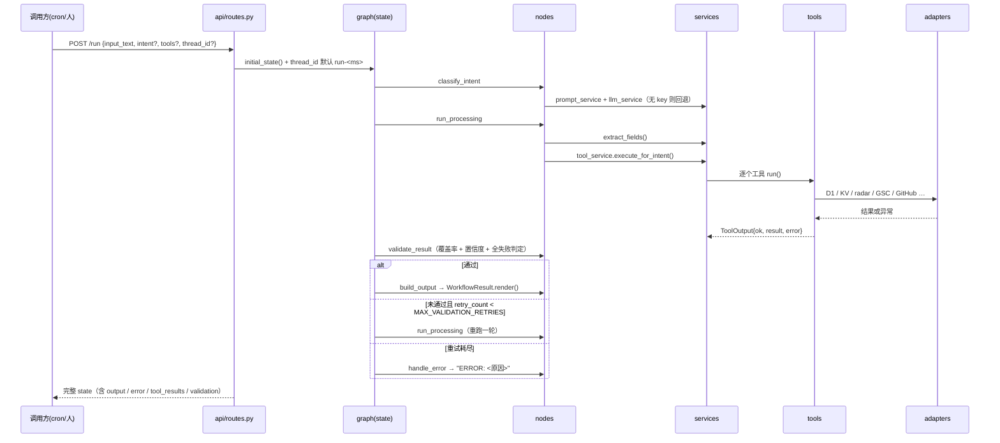
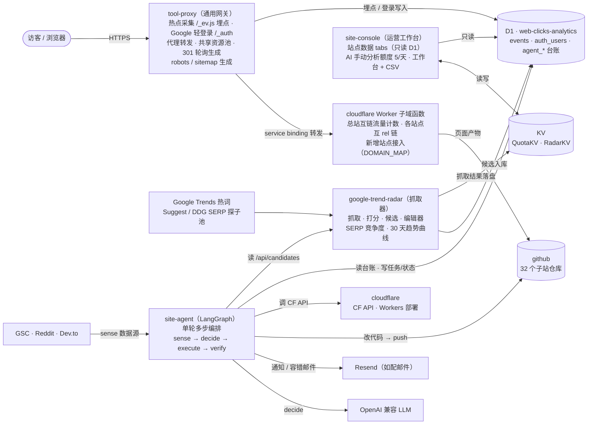

# 02 · 架构

> 一篇讲完：分成哪几层、依赖为什么只能单向、谁负责装配、一次请求在运行时怎么走、
> 部署在哪里、和站群其它系统怎么划界。

## 1. 分层

```
┌──────────────────────────────────────────────────────────────┐
│ 入口      api/routes.py（FastAPI /run /health） · main.py（CLI） │
├──────────────────────────────────────────────────────────────┤
│ 编排      graph/（builder · state · constants · edges）         │
├──────────────────────────────────────────────────────────────┤
│ 节点      nodes/（intent · processing · validation · output · error）│
├──────────────────────────────────────────────────────────────┤
│ 服务      services/（llm · prompt · tool · evaluation）         │
├──────────────────────────────────────────────────────────────┤
│ 工具      tools/（base 契约 · 6 个域 · registry 装配 · adapters）│
├──────────────────────────────────────────────────────────────┤
│ 外围      memory/ · llm/ · prompts/ · observability/ · utils/   │
└──────────────────────────────────────────────────────────────┘
        config.py（Settings 单例 + 站群清单 + 意图枚举）贯穿全局
```

| 层 | 职责 | 允许依赖 |
|---|---|---|
| `api` / `main` | 收请求、构造入口 state、返回结果 | graph |
| `graph` | 图组装、状态契约、路由条件 | nodes、memory |
| `nodes` | 单个步骤的逻辑，读 state 写 state | services、models |
| `services` | 跨节点复用的能力（LLM、prompt、工具分发、评分） | tools、prompts、llm、observability |
| `tools` | 25 个工具的定义与实现、外部 IO 适配器 | adapters（+ 包内 base） |
| `adapters` | 真实外部系统（D1 / KV / GitHub / radar / GSC / Reddit / Dev.to / Resend） | 标准库、requests、config |
| `memory` `llm` `prompts` `observability` `utils` | 基础设施 | config |

## 2. 唯一一条依赖规则

> **服务层可以依赖工具层，工具层绝不能依赖服务层。**

工具层还要再守两条更细的：

1. `tools/base.py` 是包内叶子：只依赖标准库与 pydantic，不 import 任何 `src.app.*`。
2. 工具层没有函数内 `import`：装配顺序由模块层级保证（`registry → *_tools → base`），
   不靠延迟导入解循环。`adapters/` 例外——那是为可选依赖（`google-api-python-client`）留的。

三条都由 `test/test_architecture.py` 用 AST 扫描守着，违反了先在测试里红，
而不是部署后 `ModuleNotFoundError`。

## 3. 谁负责装配

项目里只有五处「组装」，位置都是固定的：

| 装配物 | 位置 | 说明 |
|---|---|---|
| 配置 | `config.py:settings` | 唯一读 `.env` 的地方；其余模块只 import 常量 |
| 站群清单 | `config.py:SITES` ← `config/sites.json` | 站点信息是数据不是代码，重名直接抛错 |
| 实现门面 | `tools/registry.py:RuntimeService` | 6 个域 Ops 的多继承组合，本身没有实现 |
| 工具实例 | `tools/registry.py:tool_registry` | 把门面注入 25 个工具，一次构造 |
| 图 | `graph/builder.py:get_graph()` | `lru_cache(1)`，checkpointer 连接跟着复用 |

工具拿实现的唯一途径是构造注入：

```python
class RuntimeTool(BaseTool):
    def __init__(self, ops):        # registry 传进来
        self.ops = ops
    def run(self, **kwargs):
        return getattr(self.ops, self.method)(...)
```

好处是「换实现只换一处」：生产是模块级 `tool_registry`，测试是
`tool_registry.bind(FakeRuntime())`，25 个工具同时切换，没有全局单例要找。

## 4. 运行时：一次 `/run`



关键点：

- **工具失败不抛异常**。`RuntimeTool.run` 把任何异常收成 `ToolOutput(ok=false)`，
  一轮不会因为某个数据源挂掉而中断。
- **全失败不算通过**。`validation_node` 额外判一条：本轮所有工具都 `ok=false`
  时强制 `is_valid=false`，避免「字段抽全了但一个事实都没拿到」被当成成功。
- **重试是整段重跑**。`run_processing` 每次 `retry_count + 1`，
  `MAX_VALIDATION_RETRIES` 默认 2，所以最多 3 次取数。
- **线程只是归属**。`thread_id` 决定 checkpointer 里这份状态落在哪个会话，
  不参与业务判断；不传就用 `run-<毫秒>`。

## 5. 部署拓扑

站群全景（site-agent 与其它四层系统的关系）：



`render.yaml` 是完整定义：`plan: starter` + 1GB 磁盘挂 `/data`，
`buildCommand: pip install -e .`，`startCommand: uvicorn src.app.api.routes:api`，
健康检查 `/health`。生产用 `MEMORY_BACKEND=sqlite` +
`DATABASE_URL=sqlite:////data/agent.sqlite`（checkpointer 落盘 `/data/agent.sqlite`，
git 仓库副本在 `/data/repos`）。

触发方式：外部 cron 或手动 `POST /run`（console 的「Agent入口」页透传，
cron 心跳保活由 site-console 的 `*/10 1-15 * * *`（UTC）负责）。

为什么不用 Workers：没有长驻进程，也没有可持久化的图状态；Workers AI 是账户级
额度，出图站已经占了大部分。

## 6. 与站群其它系统的边界

| 系统 | 归属 | 与本项目的关系 |
|---|---|---|
| `tool-proxy` | 入口层 | 它往 D1 `events` 写埋点，本站**只读**；不改它的路由与注入逻辑 |
| `radar` | 数据层 | 本站读 `/api/candidates`（Basic Auth），不做采集、不做判死 |
| `site-console` | 界面层 | 共享 D1 / KV，但页面与统计都在那边；本站不提供 UI |
| 32 个子站仓库 | 内容 | 本站只往 `<asset_dir>/` 写页面文件并 push，不改样式与既有页面 |
| GSC / Dev.to / Resend | 外部 | 按需读写，凭据缺失即降级 |

一句话：**只在边缘新增，不改存量**。

## 7. 扩展点

| 想加什么 | 改哪里 | 副作用 |
|---|---|---|
| 一个只读能力 | 对应域 `*_tools.py` 加 `XxxOps` 方法 + 工具类；`registry.py` 的 `TOOL_CLASSES` 加一行 | 需要出现在默认编排里就再改 `INTENT_TOOLS` |
| 一个新业务域 | 新建 `xxx_tools.py`（Ops + 工具类），在 `registry.py` 的 `RuntimeService` 基类列表里加一项 | `TOOL_CLASSES` 同步登记 |
| 一个新站 | 只改 `config/sites.json` | 前提：仓库是资产目录布局、能套 `templates/site-page.html`、有 Contents 写权限 |
| 一个新意图 | `config.INTENTS` + `INTENT_TOOLS` + 需要时加 prompt 版本 | 意图是枚举，非法值会被回退成 `general` |
| 换一段 prompt | 新增 `prompts/versions/<task>/vN.txt`，请求里传 `prompt_versions` | 文件缺失回退 v1 |
| 新节点 | `graph/constants.Names` + `nodes/` + `builder.py` | 节点名必须带动词前缀，不能与 state 字段同名 |

## 8. 关键决策

| 决策 | 理由 |
|---|---|
| 编排跑在 Render（长驻进程） | 需要持久化图状态与本地 git 仓库副本，Workers 两者都给不了 |
| 用 LangGraph，但只做单轮 | 一张有向图 + 一条条件边就够；调度与重试都在外部，进程不需要跨轮状态 |
| checkpointer 用 SQLite（memory 仅本地） | 单进程、单写入者，SQLite 够用；D1 留给业务台账 |
| 写动作靠 `tools` 显式声明 | 闸门放在请求体而不是代码分支，进程不用保存「等谁批」的状态 |
| SQL 集中在 `adapters/cloudflare/sql.py` | 表名与列名只来自白名单契约，值一律占位符，热路径不拼字符串 |
| 工具实现用构造注入 | 装配在一个文件里看得见，测试一次性替换 25 个工具 |
