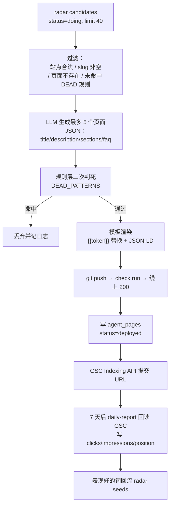
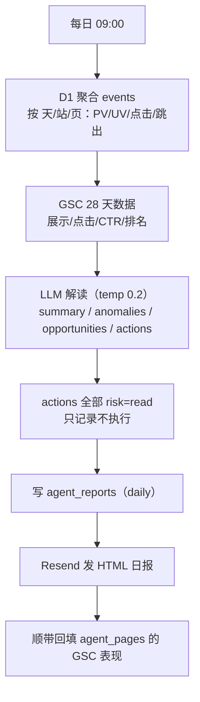
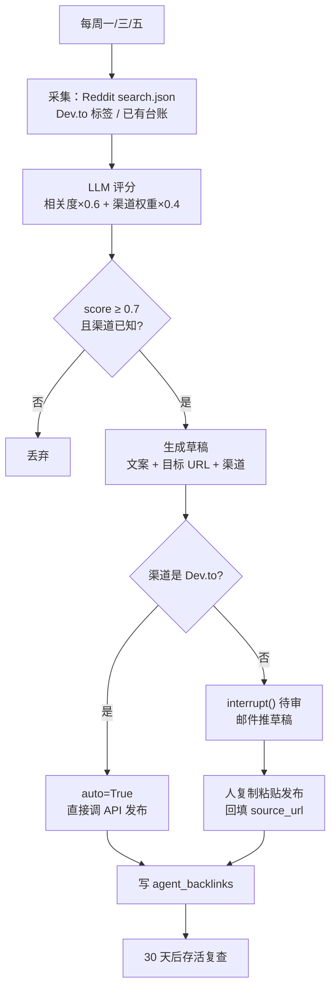
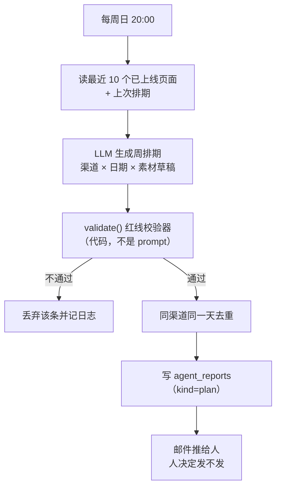

<!--
Copyright (c) 2026 lvyafei · https://toolara.dev
SPDX-License-Identifier: PolyForm-Noncommercial-1.0.0
-->

# 03 · 技术方案与实现细节

> 本文回答：**用了什么技术、为什么这么选、关键部分怎么实现、有哪些坑。**
> 写给要改代码的人。只讲实现，不讲业务背景（[01](01-background.md)）、不讲系统结构（[02](02-architecture.md)）、不讲怎么部署（[04](04-runbook.md)）。
> 文中代码片段均摘自仓库实际实现，可对照阅读。

---

## 1. 技术栈

### 1.1 选型表

| 关注点 | 选型 | 为什么是它 |
|---|---|---|
| 语言 / 运行时 | Python 3.11 + uv | 生态成熟；3.11 内存占用优于 3.12；uv 装依赖比 pip 快一个数量级 |
| 编排 | **LangGraph**（`StateGraph` + `interrupt` + checkpointer） | 五段循环天然是状态图；`interrupt()` 直接给出人审挂起点；checkpointer 免去自建任务队列 |
| 状态持久化 | `langgraph-checkpoint-sqlite` | 官方维护、零额外服务、单文件、512MB 实例能跑 |
| 调度 | APScheduler（进程内，`BlockingScheduler`） | 免起额外服务；4 条 cron + 1 条 interval 够用 |
| LLM | `openai` SDK（OpenAI 兼容端点） | 不锁厂商；换模型只改 base_url 与 model 名 |
| HTTP | `requests` | 同步模型与 LangGraph 节点函数天然匹配，不引 httpx/asyncio 双栈 |
| GSC | `google-api-python-client` + 服务账号 | 官方 API，替代浏览器抓取（见 [ADR-4](02-architecture.md#adr-4-不装-playwright)） |
| 邮件 | Resend REST（`requests` 直调） | 无需 SDK，一个 POST 就够 |
| 部署 | Render Background Worker（Starter + 1GB 盘） | 有持久盘、可常驻、无入站需求 |

### 1.2 依赖白名单

**只装这些，多一个都不加**：

```
langgraph
langgraph-checkpoint-sqlite
openai
requests
apscheduler
google-api-python-client
google-auth
```

明确不装：

| 包 | 为什么不要 |
|---|---|
| `langchain` / `langchain-community` | 全家桶只用到 3 个 API，却引入大量抽象与版本冲突 |
| `playwright` | Chromium 300-400MB，必 OOM；且真浏览器采集脆弱 |
| `celery` / `redis` | 单机串行任务，队列由 checkpointer 承担 |
| `sqlalchemy` | 只操作 D1 HTTP API，没有本地 ORM 需求 |
| `httpx` / `aiohttp` | 与同步节点函数模型冲突，不引双栈 |
| `pydantic` | TypedDict 足够；校验逻辑显式写更易读 |

### 1.3 三条工程纪律

1. **不碰 LangChain 抽象层**。不用 `Document` / `Chain` / `Retriever` / `AgentExecutor`，只用 `StateGraph` + `interrupt` + checkpointer 三件，LLM 直接调 `openai` SDK。
2. **节点是纯函数**。所有 IO 在 `cf/` 与 `tasks/`，`nodes/` 只做编排与状态搬运。换框架时业务代码零改动。
3. **锁版本**。`uv.lock` 进仓库，升级手动做并跑 `pytest`。LangGraph 迭代很快，不锁必炸。

---

## 2. 资源预算

Render Starter 是 512MB 内存 / 1GB 盘，必须在这个约束内设计。

| 项 | 估算 |
|---|---|
| Python 解释器 + langgraph + openai + requests | 180-220MB |
| APScheduler + google-api-client（按需 import） | 40MB |
| 工作内存（D1 结果集、HTML 渲染、git 操作） | 50-100MB |
| **峰值合计** | **280-360MB** |

**约束一：不装 Playwright。** Chromium 单进程 300-400MB，加上去必 OOM。

**约束二：单任务串行。** `BlockingScheduler` + 同步 `invoke`，同一时刻只有一个图在跑，内存峰值等于单任务峰值。若改成并发执行，预算立刻失效。

**约束三：checkpointer 必须在持久盘上。** Render 免费实例的文件系统随实例销毁清空，重启后所有挂起的 `interrupt` 全部丢失，人审流程会**静默失效**（表现为"发了审批邮件但永远等不到结果"）。两个选择：

| 方案 | 成本 | 说明 |
|---|---|---|
| Starter + 1GB disk（当前默认） | $7/月 | `render.yaml` 里 `mountPath: /data`，`AGENT_STATE_DIR=/data` |
| Neon 免费 Postgres + `langgraph-checkpoint-postgres` | $0 | 换一行 connector，适合零成本验证阶段 |

git 工作副本也落在 `/data/repos`，重启后不必重新 clone 33 个仓库。

---

## 3. 状态与契约

### 3.1 `OpsState`

`src/site_agent/state.py`：

```python
TaskType = Literal["gen-page", "daily-report", "backlink", "promo"]


class Action(TypedDict, total=False):
    type: str        # gen-page / devto-publish / suggest / promo-draft
    risk: str        # "read" | "write"
    auto: bool       # True = 白名单渠道免 interrupt（当前仅 Dev.to）
    key: str         # 幂等键：同一 key 的动作不重复执行
    payload: dict[str, Any]
    summary: str     # 人审邮件里展示的一句话


class OpsState(TypedDict, total=False):
    task_type: TaskType
    payload: dict[str, Any]
    observations: list[dict[str, Any]]   # sense 产出：纯数据，不含结论
    actions: list[Action]                # decide 产出：待执行动作
    executed: list[dict[str, Any]]       # execute 产出：每个动作的结果
    result: dict[str, Any] | None        # learn 产出：本轮回执
    errors: list[str]
    retry: int
```

设计要点：

- **`observations` 只放数据，不放结论**。LLM 看到的应该是"paypal 站昨天 PV 120、跳出 71%"这样的原始事实，而不是"paypal 表现不佳"这样的判断——判断是 LLM 该干的事，提前塞进去只会污染它的推理。
- **`executed` 是累积列表**，不是覆盖。因为 resume 会从头重跑 `execute` 节点，靠它做幂等去重（见 3.3）。

### 3.2 三个幂等键

系统里存在三层不同粒度的幂等，混起来会出错：

| 层级 | 键 | 作用域 | 用途 |
|---|---|---|---|
| 图状态 | `thread_id = "<task>:<YYYY-MM-DD>"` | 一次任务 | 同一天重复触发 → 只续跑，不新建 |
| 动作 | `Action.key` | 一个动作 | resume 重跑节点时，已完成的不再执行 |
| 通知 | KV `approval-sent:<action.key>` | 一个动作 | 防止每轮 resume 都重发审批邮件 |

`Action.key` 的构造在各任务里，例如：

```python
# gen_page：站点 + slug 唯一确定一个页面
key = f"gen-page:{site}:{slug}"

# backlink：渠道 + 目标 URL + 源 URL 哈希
key = f"backlink:{channel}:{target_url}:{abs(hash(source_url)) % 10**8}"

# promo：日期 + 渠道 + 序号
key = f"promo:{date}:{channel}:{idx}"
```

### 3.3 任务模块契约

每个任务是一个模块，暴露固定的 9 个符号。`tasks/__init__.py` 的文档字符串就是这份契约：

```python
NAME          str   任务名，与 OpsState.task_type 一致
LLM_PROFILE   str   llm/gateway.py 中 PROFILES 的键
PROMPT        str   llm/prompts/<PROMPT>.md

sense(state) -> list[dict]            # 采集，返回 observations
build_user_prompt(state) -> str       # 组装发给 LLM 的用户消息
parse(decision, state) -> list[Action] # 把 LLM 输出变成动作（含规则校验）
execute_action(action) -> dict        # 执行单个动作，必须幂等
verify(state) -> list[Check]          # 判定每个动作是否真的成功
learn(state) -> dict                  # 写台账 / 发通知
```

节点层完全不认识具体任务，只按 `task_type` 从注册表取模块调用。这就是"新增任务不用改节点"的实现基础。

### 3.4 LLM 输出契约

**所有 LLM 输出必须是 JSON，且由代码渲染，禁止 LLM 直出 HTML。**

理由很实际：直出 HTML 会破坏站点样式、丢失埋点注入点、且无法做结构化校验。JSON 出问题可以逐字段兜住，HTML 出问题只能整页丢。

四个任务的输出结构：

```jsonc
// gen-page → { pages: [...] }
{ "pages": [{
    "site": "paypal", "slug": "paypal-fee-for-freelancers",
    "keyword": "paypal fee calculator for freelancers",
    "title": "...", "description": "...", "h1": "...", "intro": "...",
    "sections": [{ "heading": "...", "paragraphs": ["...", "..."] }],
    "faq": [{ "q": "...", "a": "..." }]
}]}

// daily-report → { summary, anomalies, opportunities, actions }
{ "summary": "...", "anomalies": ["..."], "opportunities": ["..."],
  "actions": [{ "site": "...", "target": "...", "type": "content-fix|new-page|promo", "reason": "..." }] }

// backlink → { opportunities: [...] }
{ "opportunities": [{ "channel": "devto|reddit|directory",
    "target_url": "...", "source_url": "...", "score": 0.82,
    "reason": "...", "draft": "..." }] }

// promo → { plan: [...] }
{ "plan": [{ "date": "2026-11-09", "channel": "x|reddit|devto|youtube",
    "title": "...", "draft": "...", "approved_account": false }] }
```

三重兜底：

1. `response_format={"type": "json_object"}` 强制 JSON 模式
2. `json.loads` 失败 → 重试（最多 2 次）
3. 解析出结构后，**逐字段做代码校验**（站点是否合法、slug 是否合规、分数是否达阈值、红线是否触碰），不合格的条目直接丢弃并记日志，不阻塞其余条目

---

## 4. 图组装

`src/site_agent/graph.py`：

```python
def route_after_decide(state: OpsState) -> str:
    return "execute" if state.get("actions") else "learn"


def build_graph() -> StateGraph:
    g = StateGraph(OpsState)
    g.add_node("sense", sense)
    g.add_node("decide", decide)
    g.add_node("execute", execute)
    g.add_node("verify", verify)
    g.add_node("learn", learn)

    g.add_edge(START, "sense")
    g.add_edge("sense", "decide")
    g.add_conditional_edges("decide", route_after_decide,
                            {"execute": "execute", "learn": "learn"})
    g.add_edge("execute", "verify")
    g.add_edge("verify", "learn")
    g.add_edge("learn", END)
    return g


def compile_app(checkpoint_path: str = "data/agent.sqlite"):
    conn = sqlite3.connect(checkpoint_path, check_same_thread=False)
    return build_graph().compile(checkpointer=SqliteSaver(conn))
```

两个细节：

- **`compile_app` 全局只调一次**（`get_app()` 单例）。每次 `invoke` 新建 SQLite 连接会耗尽句柄。
- **`check_same_thread=False`** 是必需的：APScheduler 可能在不同于创建的线程里调用。

分支只有一处：`decide` 没产出动作就直接跳到 `learn`（记录"本轮无事可做"）。其他全线性——这是刻意的，分支越多越难测。

---

## 5. 人审中断

`src/site_agent/nodes/execute.py` 的核心：

```python
DONE_STATES = {"deployed", "published", "scheduled", "ready-to-post", "skipped", "rejected"}


def execute(state):
    executed = list(state.get("executed") or [])
    done = {e["key"] for e in executed if e.get("status") in DONE_STATES}

    for action in state.get("actions") or []:
        if action["key"] in done:          # 幂等：resume 重跑时跳过已完成的
            continue

        # risk=write 且非白名单渠道 → 挂起等人；Dev.to 带 auto=True 直接过
        if action.get("risk") == "write" and not action.get("auto"):
            _notify_once(thread_id, action)          # KV 标记，防重复发信
            approved = interrupt({"key": action["key"], "summary": action["summary"]})
            if not approved:
                executed.append({"key": action["key"], "status": "rejected"})
                continue

        executed.append(mod.execute_action(action))

    return {"executed": executed}
```

### 5.1 两个必须知道的行为

**行为一：resume 会从头重跑整个节点。**

LangGraph 的 `interrupt()` 恢复时，并不是"从挂起的那一行继续"，而是**重新执行整个节点函数**，只是这次 `interrupt()` 直接返回人的回复而不挂起。

所以 `execute_action` 必须幂等。三个任务各自的防重方式：

| 任务 | 防重手段 |
|---|---|
| `gen_page` | 先查 `agent_pages`，`status ∈ {deployed, indexed, verified}` 直接返回 `skipped` |
| `promo` | 追写 `agent_reports`（`kind=plan`）前先读当日已有排期，同 key 不重复追加 |
| `backlink` | 按 `Action.key` 判重；已发布的 `source_url` 不再生成动作 |

**行为二：审批邮件只能发一次。**

每次 resume 都会重新走到 `_notify_once`，如果不做标记，人会收到 N 封同样的邮件。做法是 KV 写 `approval-sent:<action.key>`，TTL 7 天。

### 5.2 恢复入口

```python
# resume.py
app.invoke(Command(resume=True), config={"configurable": {"thread_id": tid}})
```

CLI 兜底（IMAP 不可用、或调试时）：

```bash
python -m site_agent.resume 'gen-page:2026-11-05' yes
python -m site_agent.resume 'gen-page:2026-11-05' no
```

### 5.3 审批通道为什么是邮件

Background Worker 没有公网 URL，不能"点链接确认"。做一个 Web 审批后台意味着：再起一个服务、加认证、加会话、加 CSRF 防护——为了每天几次的 yes/no，不值得。

邮件方案的实现要点：

- 主题固定格式 `[site-agent] 待确认：<thread_id>`，解析时从中取 `thread_id`
- **只解析正文第一段**：用 `\n>` 与 `On ... wrote:` 切掉引用原文，否则原始邮件里的 "yes" 会被误判成批准
- 未读到明确 yes/no → **保持未读**，下轮再试，不误消费
- Gmail 必须用应用专用密码（不是登录密码）

---

## 6. IO 适配层

### 6.1 D1 客户端

`src/site_agent/cf/d1.py`，走 Cloudflare 的 D1 HTTP API：

```python
CF_API = "https://api.cloudflare.com/client/v4"


def query(sql: str, params: list | None = None) -> list[dict]:
    url = (f"{CF_API}/accounts/{os.environ['CF_ACCOUNT_ID']}"
           f"/d1/database/{os.environ['D1_DATABASE_ID']}/query")
    r = requests.post(
        url,
        headers={"Authorization": f"Bearer {os.environ['CF_API_TOKEN']}"},
        json={"sql": sql, "params": params or []},
        timeout=30,
    )
    body = r.json()
    if not body.get("success"):
        raise RuntimeError(f"D1 error: {body.get('errors')}")
    return body["result"][0]["results"]
```

**安全约束写在客户端里**：`execute()` 在发请求前检查 SQL，含 `DELETE` 直接抛异常。这不是注释提醒，是代码级拒绝——Agent 对生产库永远没有删除能力。

### 6.2 LLM 网关

`src/site_agent/llm/gateway.py`，按任务配 profile：

```python
PROFILES = {
    "content-gen":    {"model": "gpt-4o-mini", "temperature": 0.7, "max_tokens": 4000},
    "data-report":    {"model": "gpt-4o-mini", "temperature": 0.2, "max_tokens": 2000},
    "backlink-score": {"model": "gpt-4o-mini", "temperature": 0.3, "max_tokens": 800},
    "promo-plan":     {"model": "gpt-4o-mini", "temperature": 0.6, "max_tokens": 2500},
}


def json_call(task: str, system: str, user: str, retries: int = 2) -> dict:
    ensure_alive("llm")
    cfg = PROFILES[task]
    for attempt in range(retries + 1):
        try:
            resp = _client.chat.completions.create(
                messages=[{"role": "system", "content": system},
                          {"role": "user", "content": user}],
                response_format={"type": "json_object"},
                **cfg,
            )
            _usage(resp.usage)          # 累计 token，日报里展示成本
            return json.loads(resp.choices[0].message.content)
        except Exception as exc:
            record("llm", ok=False, error=str(exc))
            if attempt == retries:
                raise
```

温度按任务分档：

- 内容生成 0.7（要多样，避免 33 个站写出同一张脸）
- 数据解读 0.2（要稳定，同样的数据不应该得出相反的结论）
- 评分 0.3 / 排期 0.6

### 6.3 熔断

`src/site_agent/llm/breaker.py`，状态存 KV：

```
键：agent:pause:<scope>        值：到期时间戳
规则：同一 scope 连续失败 ≥3 次 → 写键，TTL 30 分钟
恢复：TTL 到期自动失效；或手动删键立即恢复（代码不动）
```

**fail-open 是刻意的**：KV 读失败时视为"未熔断"放行。理由——熔断器本身是保护装置，它自己挂掉不应该让业务全停。

### 6.4 部署链路

`src/site_agent/cf/deploy.py`。这是全系统最"脏"的部分，因为要跟真实 git 与真实构建流水线打交道。

```python
def deploy_page(site: SiteConfig, page: dict) -> dict:
    slug = page.get("slug", "")
    if not SLUG_RE.match(slug):        # ^[a-z0-9][a-z0-9-]{2,60}$
        raise DeployError(f"非法 slug: {slug!r}")

    work = ensure_repo(site)           # 首次 clone --depth 1，之后 fetch + reset --hard
    _write_page(work, site, page)      # 写 public/<slug>.html
    _update_sitemap(work, site, slug)  # 插 <url> 到 sitemap.xml

    git(work, "add", "-A")
    if 无变更:
        return {"ok": True, "detail": "无变更，跳过提交"}

    git(work, "commit", "-m", f"add: {slug}")
    git(work, "push", "origin", site.branch)
    sha = git(work, "rev-parse", "HEAD")

    if not wait_check_run(site.repo, sha, timeout_sec=360):
        git(work, "commit", "--allow-empty", "-m", "ci: retrigger")
        git(work, "push", "origin", site.branch)
        sha = ...
        if not wait_check_run(site.repo, sha):
            return {"ok": False, "detail": "CF 构建失败（已重推一次）"}

    ok, detail = verify_live(site, slug, page.get("title", ""))
    return {"ok": ok, "slug": slug, "sha": sha, "detail": detail}
```

四个来自实战的规则：

1. **push 后必须查 check run**。Cloudflare 的构建是通过 GitHub check run 报告的，名字含 `Workers Builds`。不查就等于不知道有没有上线。
2. **0 个 check run 就空提交重推**。多个仓库同时 push 时，GitHub 侧 check run 有 30s~4min 延迟；30 个仓库齐推更久。等不到就 `commit --allow-empty` 再推一次，这是踩过的坑。
3. **上线判定只认线上页面**。`GET https://<host>/<slug>.html?v=<随机数>`，要求 200 且响应体包含标题前 24 字符。不能因为"构建 success"就认为上线了——构建成功但静态资源缓存未生效是常见现象。
4. **slug 强校验**。`^[a-z0-9][a-z0-9-]{2,60}$`，同时防路径穿越（`../`）与非法字符。LLM 生成的 slug 一律不信任。

### 6.5 采集器

| 采集器 | 实现 | 关键约束 |
|---|---|---|
| `gsc.py` | `google-api-python-client` + 服务账号；`searchanalytics.query` 读 28 天数据；`indexing.urlNotifications.publish` 提交 URL | Indexing API 配额 200 次/天；未配置服务账号时返回空，日报降级为"仅 D1 数据" |
| `reddit.py` | `https://www.reddit.com/search.json?q=...` 公共只读接口 | 不登录、不发帖；被 429 时返回空列表，不影响其他渠道 |
| `radar.py` | 读 radar 的 `/api/candidates`（地址默认 `https://radar.<FLEET_DOMAIN>`），Basic Auth | 只读 `verdict=做` 的候选词，不改雷达任何状态 |

**GSC 服务账号必须先在 Search Console 里加为资源所有者**，否则 API 会返回 403。这一步容易漏，写在 runbook 的检查清单里。

---

## 7. 四个任务的技术实现

### 7.1 gen-page：热词 → 内容页



关键实现：

- **`DEAD_PATTERNS`**（规则层，与 radar 的 DEAD_RULES 对齐）：`("who is ", "wife", "net worth", "biography", "age of ")`。LLM 之外的第二道闸——模型偶尔会认为"某明星的身价"是个好词，规则层直接毙掉。
- **已存在页面查重**：`sense` 里查 `SELECT site, slug, keyword FROM agent_pages WHERE status != 'failed'`，`parse` 时按 `(site, slug)` 去重。避免同一页重复生成。
- **模板 token**：`lang` / `brand` / `host` / `slug` / `title` / `description` / `h1` / `intro` / `sections` / `faq` / `jsonld`。所有文本走 HTML 转义；`jsonld` 注入 `Article` + `FAQPage` 两段结构化数据。
- **每日上限**：`MAX_PAGES_PER_RUN`（默认 5）。新站首月建议降到 3——内容突增是明显的算法信号。
- **埋点不要手写**：页面里不写 `<script>`，入口代理（gateway）会自动注入 `/_ev.js`。手写会重复上报。

### 7.2 daily-report：数据解读



关键实现：

- **聚合口径**沿用站群既有写法：按天分组用 `CAST(ts/86400000 AS INTEGER)*86400000`，不要用 `date()` 函数（时区会错）。
- **列名以入口代理实际 schema 为准**，代码里集中在 `tasks/daily_report.py` 的 `SQL_DAILY` 一处。这是唯一需要按实际环境校准的地方。
- **日报的建议只记录**（`risk=read`，`type="suggest"`），不自动触发下游任务。理由：数据解读的误判率高于内容生成，让它直接触发写操作风险太大。真正执行由人看着日报决定。
- **GSC 表现回填**：按 URL 反查 `agent_pages` 的 `(site, slug)`，更新 `gsc_clicks` / `gsc_impressions` / `avg_position`，有点击的标记 `verified`。这一步把"页面产出了什么效果"闭环回台账。

### 7.3 backlink：外链机会



关键实现：

- **渠道权重**：`CHANNEL_WEIGHT` 里 Dev.to 1.0（有官方 API，可自动化）、Reddit 0.8（必须人工）、目录站 0.5（已封盘，仅记录不提交）。
- **只有 Dev.to `auto=True`**。其余渠道一律 `risk=write, auto=False`，走 `interrupt()`。这条不是配置，是硬编码。
- **草稿以"可复制文本"呈现**，不是"点击发布"。人拿到草稿自己贴——这样平台看到的是真人操作。
- **存活复查**：30 天后 `GET source_url` + 正则查是否还有目标域名，失效标 `status=dead`。

### 7.4 promo：推广排期



校验器实现（`validate()`，返回违规原因列表）：

```python
RULES = {
    "x":       "主推不得包含外链",
    "reddit":  "新号不得直接贴链接",
    "youtube": "同一音轨不得批量复用",
}

if channel == "x" and URL_RE.search(draft):
    problems.append("X 主推含外链（红线）")
if channel == "reddit" and not item.get("approved_account"):
    problems.append("Reddit 新号不贴链接（红线）")
```

为什么必须是代码：**prompt 是概率性的，校验器是确定性的**。一条"99% 遵守"的红线，跑 100 次就是 1 次事故，而这类事故（X 主推带外链、Reddit 新号贴链接）会直接损伤账号权重。

---

## 8. 数据模型

### 8.1 D1 三张台账表

与 `events` 同库，便于 join。**只增不删**。

```sql
-- 内容页台账
CREATE TABLE IF NOT EXISTS agent_pages (
  id INTEGER PRIMARY KEY AUTOINCREMENT,
  site TEXT NOT NULL,
  keyword TEXT NOT NULL,
  slug TEXT NOT NULL,
  status TEXT NOT NULL DEFAULT 'generated',  -- generated/deployed/indexed/verified/failed
  gsc_clicks INTEGER DEFAULT 0,
  gsc_impressions INTEGER DEFAULT 0,
  avg_position REAL,
  created_at INTEGER NOT NULL,
  verified_at INTEGER,
  UNIQUE(site, slug)
);

-- 外链台账
CREATE TABLE IF NOT EXISTS agent_backlinks (
  id INTEGER PRIMARY KEY AUTOINCREMENT,
  channel TEXT NOT NULL,          -- devto / reddit / directory
  target_url TEXT NOT NULL,
  source_url TEXT,
  anchor_text TEXT,
  status TEXT NOT NULL DEFAULT 'draft',   -- draft/approved/published/dead
  score REAL,
  created_at INTEGER NOT NULL,
  checked_at INTEGER
);

-- 日报 / 周报 / 排期（同一天可共存多种 kind，故联合唯一）
CREATE TABLE IF NOT EXISTS agent_reports (
  id INTEGER PRIMARY KEY AUTOINCREMENT,
  report_date TEXT NOT NULL,              -- YYYY-MM-DD
  kind TEXT NOT NULL DEFAULT 'daily',     -- daily / weekly / plan
  summary TEXT,
  anomalies TEXT,                         -- JSON
  actions TEXT,                           -- JSON
  created_at INTEGER NOT NULL,
  UNIQUE(report_date, kind)
);
```

设计决策：

- **`agent_` 前缀**：与 `events` / `candidates` 明确分区，一眼看出归属
- **`UNIQUE(site, slug)`**：数据库层兜住重复页面，即使代码逻辑出错也不会建出两页
- **`UNIQUE(report_date, kind)`**：同一天的日报（`daily`）与排期（`plan`）可以共存，但同类不能重复
- **时间戳用 `INTEGER`（Unix 秒）**：与站群 `events` 表口径一致，聚合 SQL 不用转换

### 8.2 checkpointer 表

`langgraph-checkpoint-sqlite` 自动建 `checkpoints` / `writes` 两表，**不要手工改，不要拿它做业务查询**。它只回答"这个 thread 跑到哪一步了"。

---

## 9. 安全与风控

| 风险 | 措施 | 强度 |
|---|---|---|
| LLM 生成低质/重复内容 | 每日 ≤5 页；DEAD 规则双重判死；站内 URL 查重；前 20 页人工抽查建基线 | 流程 + 代码 |
| Token 泄漏 | 细粒度权限（D1 Edit + KV Edit 仅此两项）；PAT 仅指定仓库、`contents: write`；密钥只进 Render 环境变量 | 权限设计 |
| 部署故障扩散 | 单任务失败不影响其他；同类型连续 3 次失败 → 熔断 30 分钟 + 邮件 | 代码 |
| 平台封号 | Reddit / HN / X 永不自动发帖，只出草稿；红线校验器确定性拦截 | 硬编码 |
| LLM 成本失控 | 每任务记 token；内容与解读用 mini 级；每日调用上限 100 次，超限写 KV 暂停 | 代码 |
| 数据误删 | D1 客户端拒绝 `DELETE`；KV 只写 `agent:` 前缀 | 代码级拒绝 |
| 实例重启丢状态 | checkpointer 落持久盘；`thread_id` 幂等，重启后 cron 自动续跑 | 架构 |
| 新站内容突增被惩罚 | 新站首月 ≤3 页/天；发布节奏均匀 | 配置 |
| slug 路径穿越 | `^[a-z0-9][a-z0-9-]{2,60}$` 强校验，不合法直接抛错 | 代码 |
| Agent 改坏既有站点 | 只新增文件不删不改；不改入口代理 / radar / 各站现有页面 | 权限边界 |

---

## 10. 成本

| 项目 | 费用 | 说明 |
|---|---|---|
| Render Background Worker | **$7/月** | Starter：512MB + 1GB 持久盘（免费实例磁盘是临时的，checkpointer 会丢） |
| Cloudflare D1 / KV / API | $0 | 现有额度内，增量极小（每天几十行写入） |
| GSC API / Indexing API | $0 | 免费，Indexing 配额 200 次/天 |
| LLM（mini 级） | **$3-8/月** | 日报 1 次/天 + 内容 5 页/天 + 评分 15 次/周 |
| Resend | $0 | 免费 100 封/天，实际每天 1-3 封 |
| Dev.to / Reddit / YouTube API | $0 | 免费额度 |
| **合计** | **$10-15/月** | 想零成本验证：Render 免费实例 + Neon 免费 Postgres 做 checkpointer |

一个参考值：LLM 部分最贵的是内容生成，一页约 2-4k tokens。按 mini 级单价算，5 页/天约 $0.1-0.15/天，也就是**一页内容的边际成本不到 3 美分**。

---

## 11. 已知限制与技术债

诚实记录，避免后来者踩同样的坑。

| 项 | 现状 | 影响 | 计划 |
|---|---|---|---|
| `events` 表列名未对齐 | `SQL_DAILY` 按推测 schema 写 | 日报可能取不到数 | 阶段 0 按实际 schema 校准（改一处） |
| `config.SITES` 只配了 5 个 AI 站 | 计算器站未纳入内容生成 | 计算器站无法自动加页 | 按需补 `SiteConfig`，但要先确认模板适配 |
| radar 接口路径未实测 | `collectors/radar.py` 按约定写 | 取不到候选词则 gen-page 跳过 | 阶段 0 联调 |
| 无并发控制 | 单进程串行 | 任务耗时叠加时可能撞车 | 任务间隔已错开，暂不需要 |
| 无指标监控 | 只有日志与邮件 | 出问题依赖人看邮件 | 阶段 5 加简单心跳 |
| GSC 只读 28 天 | 更长周期趋势看不到 | 长期效果判断受限 | 阶段 5 |
| 熔断计数存进程内存 | 重启后计数归零 | 进程频繁重启时熔断可能不触发 | 可接受（真故障会持续，几次内仍会触发） |
| 日报建议不自动执行 | `risk=read` | 少一环自动化 | 阶段 5 评估误判率后再放开 |

---

## 12. 代码地图

```
site-agent/
├── docs/                          # 文档（见 docs/README.md 索引）
├── src/site_agent/
│   ├── config.py                  # 环境变量 + SITES 映射 + 上限常量
│   ├── main.py                    # APScheduler 入口，4 条 cron + 1 条审批轮询
│   ├── graph.py                   # StateGraph 组装 + 编译（SqliteSaver）
│   ├── state.py                   # OpsState / Action / Check 类型
│   ├── resume.py                  # Command(resume) 封装 + CLI
│   ├── approvals.py               # IMAP 轮询审批回复
│   ├── nodes/                     # 编排层：只搬运状态，不做 IO
│   │   ├── sense.py               #   熔断检查 → 分发到 task.sense
│   │   ├── decide.py              #   唯一 LLM 调用点
│   │   ├── execute.py             #   幂等去重 → interrupt() → task.execute_action
│   │   ├── verify.py              #   task.verify → 失败计熔断
│   │   └── learn.py               #   task.learn → 写台账 / 发通知
│   ├── tasks/                     # 业务层：每类任务的语义
│   │   ├── __init__.py            #   注册表 MODULES + get_task()
│   │   ├── gen_page.py            #   用例一：热词 → 内容页
│   │   ├── daily_report.py        #   用例二：数据解读（含 GSC 回填）
│   │   ├── backlink.py            #   用例三：外链机会
│   │   └── promo.py               #   用例四：推广排期 + validate() 红线校验器
│   ├── cf/                        # IO 层：会改变外部世界的地方
│   │   ├── d1.py                  #   D1 HTTP 客户端（拒绝 DELETE）
│   │   ├── kv.py                  #   KV 读写（agent: 前缀）
│   │   └── deploy.py              #   渲染 → push → check run → 线上校验
│   ├── llm/
│   │   ├── gateway.py             #   json_call + PROFILES + token 计数
│   │   ├── breaker.py             #   熔断（KV，fail-open）
│   │   └── prompts/*.md           #   四份 prompt，与任务一一对应
│   ├── collectors/                # 只读采集
│   │   ├── gsc.py                 #   官方 API + Indexing
│   │   ├── reddit.py              #   search.json（不登录）
│   │   └── radar.py               #   读候选词
│   └── notify/mail.py             # Resend：日报 / 告警 / 审批
├── templates/site-page.html       # 内容页模板（{{token}} 占位）
├── migrations/0001_agent_tables.sql
├── test/test_validators.py        # 7 项：红线校验器 + slug 安全
├── pyproject.toml / uv.lock
├── render.yaml
└── .env.example
```

**读代码的建议顺序**：`state.py`（数据结构）→ `graph.py`（流程骨架）→ `nodes/execute.py`（最巧妙的一处）→ `tasks/gen_page.py`（最完整的一条链路）→ `cf/deploy.py`（最容易出错的一段）。

---

## 13. 延伸阅读

- 系统结构与决策权衡 → [02-architecture.md](02-architecture.md)
- 部署、配置、排障 → [04-runbook.md](04-runbook.md)
- 分阶段计划与当前进度 → [05-roadmap.md](05-roadmap.md)
- 名词解释 → [glossary.md](glossary.md)
