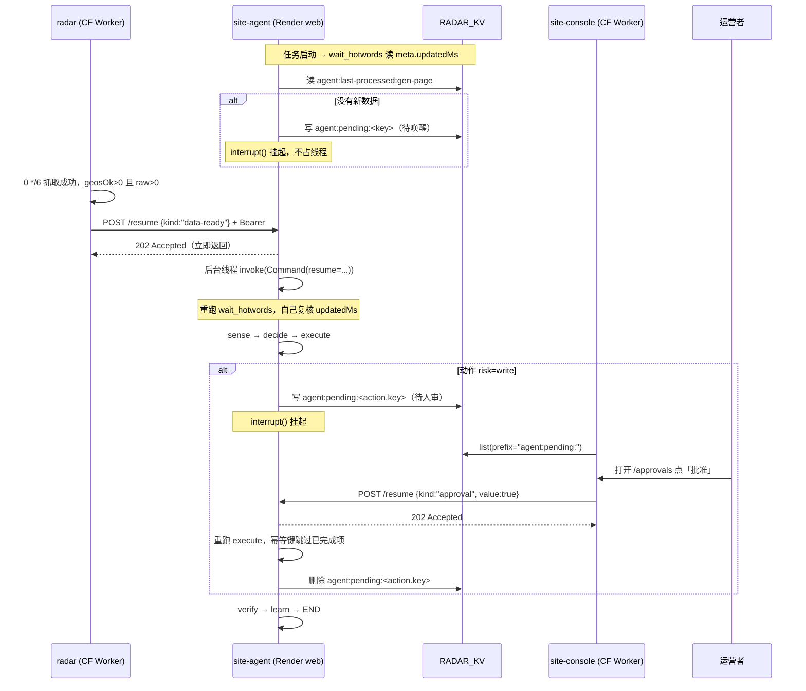

<!--
Copyright (c) 2026 lvyafei · https://toolara.dev
SPDX-License-Identifier: PolyForm-Noncommercial-1.0.0
-->

# 06 · 事件驱动 resume 与控制台人工确认（改造方案）

> **状态：待评审，未实施。** 本文描述目标形态；代码现状仍以 [01](01-background.md) ~ [05](05-roadmap.md) 为准。
> 本文回答：怎么把「邮件审批 + IMAP 轮询 + 定时硬跑」改成「radar 通知 / console 点击 → HTTP resume」，以及改完各仓库要动哪些文件。
>
> 2026-11-07 已拍板的三条：① **本轮只出方案，不动代码**；② 对外地址**收敛成一个环境变量**，先用 Render 自带 `onrender.com`，跑稳后再换 `*.toolara.dev` 子域；③ **邮件审批通道完全删除**，只留 site-console 人工确认入口。

---

## 1. 结论与边界

**可行，整体比现状好**：`gen-page` 不必再按点空跑，改成「有新热词才往下走」；人审从邮件搬到 console，反馈从「等 5 分钟轮询」变成「点完立即续跑」。

**一个硬前提**：Render 官方规定 **Background Worker / Cron Job 没有公网入站，也不支持自定义域**，只有 web service 能绑域名。`render.yaml` 当前是 `type: worker`，所以「radar 调 Render 接口」现在物理上不成立，必须先改成 `type: web`。

| | 现状 | 改后 |
|---|---|---|
| 服务类型 | `type: worker` | `type: web`（`BackgroundScheduler` 与 HTTP server 同进程） |
| 常驻理由 | IMAP 5 分钟轮询 | 接 `/resume` 请求 |
| 月度成本 | Starter $7 + 1GB 盘 | **不变**，Starter $7 + 1GB 盘 |
| 人审通道 | 发邮件 + 回 yes/no + IMAP 轮询 | console 页面点击 |
| 触发方式 | 4 条 cron 到点硬跑 | cron 到点 + 数据/人工事件唤醒 |
| 对外地址 | 无 | 一个 `AGENT_API_URL` 环境变量（先 `onrender.com`） |

**三个不变**：radar 采集逻辑一行不改；`0 */6` 抓取 cron 不动；成本不增加。**不要降回免费层**——免费 web service 15 分钟无请求休眠、冷启动 30–60 秒，且磁盘临时会丢挂起的 checkpointer（见 [03 §2](03-tech-design.md#2-资源预算)）。

---

## 2. 目标形态



这张图在说什么：**两条等待线共用同一个 `/resume` 接口**——radar 通知「数据到了」，人点击「批准」，agent 都只是被唤醒后重跑节点、自己复核状态，不盲信通知内容。

---

## 3. 接口契约

### 3.1 `POST /resume`（site-agent 提供）

| 项 | 值 |
|---|---|
| 鉴权 | `Authorization: Bearer <AGENT_RESUME_TOKEN>`，常量时间比较；失败 401 JSON |
| Content-Type | `application/json` |
| 超时 | 立即返回，不等待 graph 跑完 |

请求体：

```json
{
  "thread_id": "gen-page:wait",
  "kind": "data-ready",
  "value": {"updatedMs": 1794000000000, "reason": "hotwords-updated"},
  "source": "radar",
  "note": "0 */6 抓取成功 geosOk=16/16"
}
```

| 字段 | 必填 | 说明 |
|---|---|---|
| `thread_id` | 否 | 省略时 agent 按 `kind` 查挂起索引；只对上一条挂起线程生效 |
| `kind` | 是 | `data-ready` / `approval`，必须与挂起时 `interrupt()` 的 `kind` 一致，不一致回 409 |
| `value` | 是 | 原样传给 `Command(resume=...)`。`approval` 传 `true`/`false`；`data-ready` 传对象或 `true`（节点会自己复核，值不作事实依据） |
| `source` | 是 | `radar` / `console`，只写日志，不参与判断 |

响应：

| 状态 | 含义 |
|---|---|
| `202` | 已接受，后台线程开始 `app.invoke(Command(resume=value))` |
| `204` | 没有匹配的挂起线程（radar 无条件通知时的正常结果） |
| `401` | token 不对 |
| `409` | `kind` 不匹配，或该 thread 已有一次 resume 在执行 |
| `400` | 缺 `kind` / JSON 非法 |

**两条实现硬约束**：① 处理函数**必须立即返回 202**，把 `invoke` 丢进后台线程——否则 radar 的 cron 会卡到整个 graph 跑完；② 按 `thread_id` 加进程内锁，防止 radar 通知与人工点击并发触发同一 thread 双跑（`coalesce`/`max_instances=1` 只管 cron，不管 HTTP）。`graph.py` 的 `check_same_thread=False` 已经为跨线程调用准备好了。

### 3.2 待审清单（console 侧，不新增 agent 接口）

agent 挂起时写，console 直读同一个 namespace，**不额外跨云调用**：

| 键 | 值 | 生命周期 |
|---|---|---|
| `agent:pending:<key>` | `{thread_id, kind, summary, payload, created_at, updatedMs}` | agent 执行完成后删除；TTL 7 天兜底 |
| `agent:last-processed:gen-page` | `updatedMs` 整数 | 长期保留，作为「新热词」的比较基准 |

console 用 `env.RADAR_KV.list({ prefix: 'agent:pending:' })` 枚举再逐个 `get`。**KV 的 list 是最终一致**，写入后可能有几十秒延迟，页面标注「如未显示请稍后刷新」即可，不必为此引入强一致存储。

### 3.3 radar → agent 通知

挂点在 `runRefresh(env)` 返回 `meta` 之后。判据 `meta.geosOk > 0 && meta.raw > 0`——复用 2026-11-06 加的失败检测，**抓取全挂时不通知**。调用放 `ctx.waitUntil`，异常只记日志，绝不影响抓取本身。

```json
POST {AGENT_API_URL}/resume
{"kind":"data-ready","value":{"updatedMs":<meta.updatedMs>},"source":"radar"}
```

radar 不需要知道 agent 有没有挂起：无条件 POST，收到 204 视为正常。这是最解耦的写法。

### 3.4 console → agent

`POST /api/approvals/resume`（console 的本地接口，带 console 自身 Basic Auth）→ 转发到 `AGENT_API_URL + '/resume'`，body 带 `kind: "approval"`、`value: true|false`、`source: "console"`。console 不删 KV 键，由 agent 执行完成后删，避免「点了但执行失败」时清单消失。

---

## 4. 关键设计决策

| # | 决策 | 依据 | 代价 |
|---|---|---|---|
| D1 | 「有新热词」判据用 **`meta.updatedMs` > `agent:last-processed:gen-page`**，不是「candidates 非空」 | `candidates` 是累计词库 top150，几乎永远非空；`updatedMs` 是每轮抓取时间戳，radar 的 `/api/candidates` 已经在返回 `meta`，只是 `collectors/radar.py` 把它丢了 | 需把 `meta` 从 collector 透出来 |
| D2 | 新增**独立节点** `wait_hotwords`，`START → wait_hotwords → sense`，只在 `gen-page` 走条件边 | `sense` 被 4 类任务共用，daily-report / backlink / promo 不该等热词；独立节点重跑时只重跑一个纯读检查，不重跑整批采集 | 图多一条条件边 |
| D3 | **通知只当唤醒信号**，节点重跑后自己复核 `updatedMs` | LangGraph 的 resume 会**重跑整个节点**（[03 §5.1](03-tech-design.md#51-两个必须知道的行为)），这正好实现「重新读一次」；雷达误报、重复通知、抓取失败后误通知都不会产生错误动作 | 每次唤醒多一次 KV/radar 读 |
| D4 | 等待型任务的 `thread_id` 改成**稳定值** `gen-page:wait` | 现在 `main.py:43` 是 `f"{task_type}:{date.today().isoformat()}"`，等待跨天就换新 thread，旧线程永远等不到 resume，且第二天又新建一个挂起 | 同日「想干净重跑」要显式换 ID 或删 checkpoint |
| D5 | `interrupt()` 的 payload 与 resume 值**结构化**，带 `kind` | 现 `execute()` 把返回值当 bool（`if not approved: rejected`），新增 `data-ready` 后两套语义会互相误判 | `resume.py` 要泛化 |
| D6 | `/resume` 异步 202 + 后台线程 + per-thread 锁 | 见 §3.1 | 进程内状态，单实例才成立（当前就是单实例） |
| D7 | **挂起超时兜底**：`max_wait_hours` 建议 12，超过则由兜底 cron 重新检查并放弃/重排 | 通知可能丢，radar 可能连续失败；没有兜底线程会永久挂起 | 多一条 cron |
| D8 | agent 的 `KV_NAMESPACE_ID` **统一为 `3cb9c51a017748319ae9924b08ded64c`**（radar / console 的 `RADAR_KV`） | agent 的键全是 `agent:` 前缀（`cf/kv.py` 自动加），radar 不做全库 `list` 遍历，前缀隔离安全；console 已绑该 namespace，零新增绑定 | 需确认 `CF_API_TOKEN` 对该 namespace 有写权限；见 §9 待拍板 |
| D9 | 邮件**只删审批链路**，保留 `notify/mail.py` 的 `send` / `send_alert` | `send_alert` 被 `llm/breaker.py` 用，日报 / 外链 / 推广三个 task 也 import 了 `mail`；整个删会切断熔断告警与日报 | `RESEND_API_KEY` / `ADMIN_EMAIL` / `CONTACT_EMAIL` 保留 |
| D10 | 对外地址只用一个 `AGENT_API_URL` 环境变量（radar / console 各配一份） | 换子域时只改配置，代码零改动；先用 `https://site-agent-xxx.onrender.com`，零 DNS、零证书等待 | 自带域名不好看；纯机器间调用，无人访问 |

---

## 5. 逐文件改动清单

### 5.1 `site-agent`（核心）

| 文件 | 改动 |
|---|---|
| `render.yaml` | `type: worker` → `web`；`startCommand` 改为起 HTTP server（`uv run python -m site_agent.api`，`PORT` 由 Render 注入）；加 `healthCheckPath: /health`；**删** `IMAP_HOST/USER/PASS`；**加** `AGENT_RESUME_TOKEN`；`plan: starter` 与 `disk` 保持不动 |
| `src/site_agent/api.py` | **新增**。`ThreadingHTTPServer` + `BaseHTTPRequestHandler`，零新依赖：`GET /health`、`POST /resume`。含 Bearer 常量时间比较、参数校验、202 异步派发、per-thread 锁、结构化日志 |
| `src/site_agent/main.py` | `BlockingScheduler` → `BackgroundScheduler`（否则 `sched.start()` 阻塞，HTTP server 起不来）；`run_task` 的 `thread_id` 按 D4 稳定化；删 `job_approvals` 与 5 分钟 interval job；`main()` 同时启动 server 与 scheduler |
| `src/site_agent/graph.py` | 新增 `wait_hotwords` 节点；`START → wait_hotwords`；按 `task_type == "gen-page"` 走条件边，其余任务直连 `sense` |
| `src/site_agent/nodes/wait_hotwords.py` | **新增**。读 `meta.updatedMs` 与 `agent:last-processed:gen-page`；无新数据 → `interrupt({"kind":"data-ready", ...})` 并写 `agent:pending:`；resume 后重跑本节点复核，通过则写回 `last-processed` 并放行 |
| `src/site_agent/state.py` | `OpsState` 加 `data_ready` / `wait_reason` / `last_updated_ms` |
| `src/site_agent/resume.py` | `resume(thread_id, approved: bool)` → `resume(thread_id, value)`，`Command(resume=value)`；CLI 命令保留作调试兜底，参数支持 `yes/no/data-ready` |
| `src/site_agent/nodes/execute.py` | `_notify_once` 改为写 `agent:pending:<key>`（不再调 `mail.send_approval_request`）；`interrupt()` payload 加 `kind: "approval"`；返回值按 `kind` 解析；执行完成删 pending 键 |
| `src/site_agent/approvals.py` | **删除**（整份 IMAP 轮询） |
| `src/site_agent/notify/mail.py` | 只删 `send_approval_request` 函数与相关注释；`send` / `send_alert` 保留 |
| `src/site_agent/collectors/radar.py` | 新增 `meta()`（或让 `candidates()` 返回 `(items, meta)`），把 `/api/candidates` 已有的 `meta` 透出来；顺带修正现状：`status` / `limit` 参数 radar 并不解析，是 agent 自己 `[:limit]` 截的 |
| `src/site_agent/cf/kv.py` | 不改代码；**配置上**把 `KV_NAMESPACE_ID` 指向 D8 的 namespace |
| `.env.example`、`docs/04-runbook.md §3` | 删 IMAP 三项；加 `AGENT_RESUME_TOKEN`、超时阈值；三处环境变量表保持一致 |
| `test/` | 新增：`wait_hotwords` 有/无新数据两分支、resume 后重跑复核、thread_id 跨天稳定、kind 不匹配拒绝、token 校验、202 异步、并发锁 |

### 5.2 `google-trend-radar`

| 文件 | 改动 |
|---|---|
| `src/index.js` | 抽 `notifyAgent(env, meta)`：仅在 `meta.geosOk > 0 && meta.raw > 0` 时 POST；在 `/api/refresh` 与 `scheduled` 两条抓取路径都挂上，放 `ctx.waitUntil`，try/catch 吞异常 |
| `wrangler.toml` | 注释新增 `AGENT_API_URL` / `AGENT_RESUME_TOKEN` 两个 secret |
| `test/run.mjs` | 桩测试：抓取成功才通知、16 区全失败不通知、通知异常不影响 `runRefresh` 返回 |

**不改动**：`trends.js` / `seeds.js` / `analyze.js` / `store.js` 的采集与判死逻辑。

### 5.3 `site-console`

| 文件 | 改动 |
|---|---|
| `src/approvals.js` | **新增**。`GET /api/approvals`（读 `RADAR_KV.list({prefix:'agent:pending:'})`）、`POST /api/approvals/resume`（转发到 `AGENT_API_URL`） |
| `src/index.js` | `PAGES` 加 `/approvals`；`LOCAL_API` 挂两个新接口 |
| `public/approvals.html` + `public/assets/approvals.js` | **新增**页面：待审卡片（summary / payload / 等待时长）+ 批准 / 拒绝按钮，沿用现有 Basic Auth 与样式变量 |
| 各页面菜单 | 加「人工确认」入口 |
| `wrangler.toml` | 注释新增 `AGENT_API_URL` / `AGENT_RESUME_TOKEN`；若 D8 不成立，则加 `AGENT_KV` binding |
| `test/stats.test.mjs` | 新增：待审列表、批准/拒绝转发、token 不透传、异常回 502 |

---

## 6. 环境变量与 secret

| 名称 | 配在哪 | 变化 |
|---|---|---|
| `AGENT_API_URL` | radar、console | **新增**；先填 `https://site-agent-xxx.onrender.com`，换子域时只改这一处 |
| `AGENT_RESUME_TOKEN` | agent、radar、console | **新增**，三处同值，独立随机串。**不要复用 `RADAR_PASS`**（那是 console→radar 的 service binding 鉴权） |
| `KV_NAMESPACE_ID` | agent | **改为** `3cb9c51a017748319ae9924b08ded64c`（D8） |
| `IMAP_HOST` / `IMAP_USER` / `IMAP_PASS` | agent | **删除** |
| `RESEND_API_KEY` / `ADMIN_EMAIL` / `CONTACT_EMAIL` / `MAIL_FROM` | agent | **保留**（熔断告警、日报、推广草稿仍发信） |
| `MAX_WAIT_HOURS` | agent | **新增**，默认 12 |
| `TZ` / `AGENT_STATE_DIR` / `PORT` | agent | `PORT` 由 Render 注入，其余不动 |

---

## 7. 部署顺序

| 步 | 动作 | 验证点 |
|---|---|---|
| 1 | 生成随机 `AGENT_RESUME_TOKEN`；确认 `KV_NAMESPACE_ID` 要统一（§9） | — |
| 2 | 本地改 `site-agent` 代码，跑 `pytest` | 全绿；本地起 server 手动 POST `/resume` 得 202，日志出现 `Command(resume=...)` |
| 3 | 推 GitHub，**在 Render 面板确认 `type: web` 变更后 1GB 盘 `/data` 仍在**（别丢 checkpointer） | `/health` 返回 200；Render Logs 显示 scheduler 与 server 都启动 |
| 4 | Render 配 env；记录自带 `onrender.com` 域名 | `curl -H "Authorization: Bearer ..." -X POST .../resume` 无挂起时回 204 |
| 5 | radar 配两个 secret 并部署 | 手动点「重新抓取」→ agent 日志出现一次 `data-ready` 唤醒；把 `geosOk` 桩成 0 验证不发通知 |
| 6 | console 配两个 secret 并部署 | `/approvals` 能列出挂起项；人工批准 → agent 从 `execute` 断点续跑、pending 键消失 |
| 7 | 观察 1~2 周 | 无重复执行、无永久挂起、无重复发信；确认后清理 IMAP 邮箱与凭据 |
| 8 | **（后续，单独一次）** 换子域 | CF 加 CNAME `agent` → `xxx.onrender.com`，**Proxy status = DNS only（灰云）** → Render Custom Domains 验证并签发证书 → 只把 `AGENT_API_URL` 改成 `https://agent.toolara.dev`，代码零改动 |

第 8 步的三个坑：Render 自己也用 Cloudflare，橙云会拦截域名验证导致 Let's Encrypt 签不下来；有 CAA 记录要放行 `letsencrypt.org` / `pki.goog`；删掉该子域 AAAA（Render 仅 IPv4）。灰云的额外好处是请求直接到 Render，**完全绕开 Cloudflare Worker Routes**，因此不会与 tool-proxy 的路由冲突（`tool-proxy/wrangler.toml` 里没有 routes，是面板配置，部署前到 CF 面板确认一次即可）。

---

## 8. 验收清单

- [ ] `pytest -q test` 全绿；三仓库 `node --check` / `npm test` 全绿
- [ ] radar 抓取全失败时不发通知；成功时恰好发一次
- [ ] agent 无挂起线程时 `/resume` 返回 204，不报错
- [ ] 等待跨天后 radar 通知仍能唤醒**同一个** thread（D4）
- [ ] 同一 thread 并发两次 `/resume`，第二次返回 409，graph 只跑一次
- [ ] 人工拒绝后 `executed` 记 `rejected`，pending 键清除
- [ ] 邮件审批入口与 `approvals.py` 已从仓库彻底移除；`send_alert` 仍能发熔断告警
- [ ] 挂起超过 `MAX_WAIT_HOURS` 由兜底 cron 处理，不出现僵尸 thread
- [ ] 全流程无重复建页（依赖现有 `agent_pages` 去重与 `executed` 幂等列表）

---

## 9. 风险与待拍板项

| # | 事项 | 建议 |
|---|---|---|
| P1 | **KV namespace 是否统一**（D8） | 建议统一到 `3cb9c51a…`，少一个绑定；若你希望 agent 状态与雷达数据物理隔离，则 console 加一个 `AGENT_KV` binding，`src/approvals.js` 改读它，其余不变 |
| P2 | 待审清单走 KV `list` 还是 agent `GET /approvals` | 建议 KV `list`：少一次跨云调用；代价是最终一致的短暂延迟。若要求强实时，再改 agent 接口 |
| P3 | `render.yaml` 改 `type` 会不会导致 Render 重建服务 / 丢盘 | 部署前在面板确认 `/data` 挂载保留；这是本方案**唯一可能丢状态**的一步，务必先备份 `agent.sqlite` |
| P4 | `MAX_WAIT_HOURS` 取值 | 建议 12（radar `0 */6`，覆盖两次抓取）；太短会把网络抖动误判成放弃 |
| P5 | 删除邮件后失去兜底通道 | console 或 Render 接口故障时无人审可用。建议保留 `resume.py` 的 CLI 作为本地兜底（已在改动清单中） |

---

## 10. 明确不做

- **不改 radar 采集源、判死规则、候选池打分**——本方案只加一条出站通知。
- **不引入 FastAPI / uvicorn / Celery / Redis**——`http.server` 约 20 行够用，维持 [03 §1.2](03-tech-design.md#12-依赖白名单) 的依赖纪律。
- **不换 checkpointer**——继续用 `SqliteSaver` + 1GB 持久盘；Neon Postgres 是「彻底无常驻」路线才需要的，与本方案无关。
- **不降 Render 计费层**——免费层休眠 + 临时盘会让挂起状态静默失效。
- **本轮不改代码**——以上均为待评审方案，评审通过后再按 §7 顺序实施。
