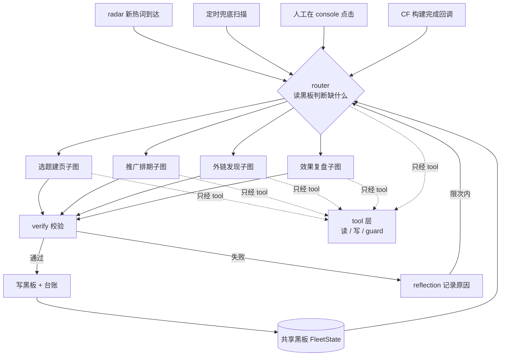

<!--
Copyright (c) 2026 lvyafei · https://toolara.dev
SPDX-License-Identifier: PolyForm-Noncommercial-1.0.0
-->

# 08 · Agent 优先：tool 化、共享状态与单图运营闭环

> **状态：待评审，未实施。** 本文只描述目标形态与设计判据，不改代码。
> 评审通过并实施后，内容合并进 `02-architecture.md` / `03-tech-design.md` / `04-runbook.md`，本文件删除，避免同一主题两处留档。

---

## 1. 结论先行

三个问题的答案：

1. **哪些是 tool**：当前 16 个外部 IO 点全部散在 `tasks/*.py` 里裸调，应收敛成约 14 个 tool + 3 个 guard（§3）。tool 化是 ReAct 的**必要前提**，但不是充分条件——`decide.py` 的文档字符串写着「唯一调用 LLM 的地方」，且 LLM 输出的是自定义 `actions` JSON 而非 `tool_calls`，这才是当前不是 ReAct 的技术原因（§2）。
2. **为什么不是 graph 模式**：`graph.py` 已经是 `StateGraph`，prompt chaining 只是无分支图的特例。真实问题不是 chain 还是 graph，而是**四条任务被实现成同一张线性图跑四遍**，任务之间一条边都没有（§4）。
3. **四条任务独立吗**：LangGraph 层独立（各自 `thread_id`、各自 checkpoint），业务层**不独立**——有 5 条真实依赖，但全是 D1 台账的隐式耦合，且最关键的一条「效果 → 下一轮选题」是断的（§4）。

**站在 Agent 设计上，顺序要反过来**：先定义 Agent 眼里的世界状态（共享黑板），再定义它能调用的能力（tool + 权限边界），再让 LLM 决定用哪些能力（策略），最后才用图去约束策略（编排）。当前 `tasks/*.py` 把这三件事揉在同一个 `sense()` 里：决定读什么（策略）、怎么读（能力）、读失败怎么办（编排），所以既不能复用，也不能被 LLM 自主组合。

**需要纠正此前一处判断**：`07-graph-patterns.md` §3 写过「ReAct 会绕过 ADR-6 确定性校验器，因此明确减分」。该结论的前提是红线写在节点/任务层。若把红线下沉到 **tool 实现内部 + tool 调用前后的 guard**，LLM 自由选 tool 也绕不过去，ReAct 就不再与 ADR-6 冲突。tool 化正是让它变安全的前提，而不是相反。

---

## 2. 三层正交

| 层 | 职责 | 当前落点 | 目标落点 |
|---|---|---|---|
| **能力层** tool | 原子、可组合；自带鉴权、幂等、校验、审计、限流 | `tasks/*.py` 里裸 `requests` / `d1.query` / `deploy.*` / `mail.send` | `src/site_agent/tools/` |
| **策略层** LLM | 决定「下一步调哪个 tool、参数是什么」 | `decide.py` 独占 `gateway.json_call`，输出自定义 `actions` JSON | `bind_tools` + `ToolNode` + 条件循环边 |
| **编排层** graph | 约束策略边界：哪些节点能调哪些 tool、何时强制 HITL、失败如何回流、状态如何共享 | `graph.py` 五节点线性 + 1 个条件边 | 多入口 router + 子图 + 回边 + 共享黑板 |

三层互相独立：能力层与编排模式无关（chain 也能用 tool）；策略层换成 ReAct 不改能力层；编排层从 4 条链改成 1 个闭环不必重写 tool。

**ReAct 的准确边界**：LangGraph 官方把 tool-calling loop 归在 `Agents` 一节，ReAct 是它的经典形式。要真正进入这一形态，三件事缺一不可：

- LLM 用 `bind_tools` 拿到 tool schema，输出 `tool_calls` 而不是自定义 JSON
- `ToolNode` 执行 tool，条件边 `tools_condition` 决定继续调用还是结束
- 有 `recursion_limit` 与调用预算上限，防止无限循环

只做 tool 化而不改 LLM 的输出契约，仍然是「固定图 + 函数抽取」，不是 ReAct。这一点在验收时要单独测。

---

## 3. Tool 契约清单

**读 tool（感知，只读，可自由调用）**

| Tool | 现在在哪裸调 | 说明 |
|---|---|---|
| `get_hotwords` | `collectors/radar.py` GET `/api/candidates` | 必须连 `meta.updatedMs` / `geosOk` 一起返回，不能只给 candidates |
| `get_click_stats` | `daily_report.py` 的 `SQL_DAILY` / `SQL_TOP_PAGES` | 按真实 events schema；UV 用 `COUNT(DISTINCT sid)` |
| `get_page_inventory` | `gen_page.py` / `promo.py` / `daily_report.py` 各写一遍 `SELECT ... FROM agent_pages` | 三处语义不同（查重 / 最近 10 页 / 待回流），应是一个 tool 加参数 |
| `get_latest_plan` | `promo.py` 读 `agent_reports(kind='plan')` | — |
| `get_backlink_ledger` | `backlink.py` 读 `agent_backlinks` | — |
| `get_search_analytics` | `collectors/gsc.py` | — |
| `search_reddit` | `collectors/reddit.py` | — |
| `list_devto_articles` | `backlink.py:50` 内联 `requests.get` | 目前连超时/异常处理都重复写 |
| `get_build_status` | `deploy.py:157` `_check_runs` | — |
| `check_live_page` | `deploy.py:183` `verify_live` | — |
| `get_flag` | `cf/kv.py` | 熔断 / 审批 / 用量 |

**写 tool（行动，强制权限 + 幂等 + 审计）**

| Tool | 现在在哪裸调 | 约束 |
|---|---|---|
| `publish_page` | `deploy.py:197` `deploy_page`（内含 render / git / sitemap / 等构建 / 验活） | **必须拆**：`render_files` / `git_push` / `wait_build` / `check_live` 四个独立 tool，否则一次 resume 重放会重复部署 |
| `submit_indexing` | `gsc.submit_url` | 普通内容页 Indexing API 不生效，应改走 sitemap；需先定策略 |
| `write_ledger` | `d1.execute`（`gen_page` / `promo` / `backlink` / `daily_report` 各写） | 统一 UPSERT + 唯一键，禁止裸 INSERT |
| `publish_devto_article` | `backlink.py:129` `_publish_devto`，`published=True` | 目前 `auto=True` 跳过 `interrupt()`，是最危险的一段；必须强制 HITL + 内容校验 + 域名白名单 |
| `send_notice` / `request_approval` | `notify/mail.py` | 06 方案要把审批通道换成 console |
| `set_flag` | `cf/kv.py` | 幂等键要含 thread_id，否则同一动作二次出现永久挂起 |

**Guard（不是 LLM 可自由选的 tool，而是 tool 执行前后的拦截器）**

| Guard | 来源 | 作用 |
|---|---|---|
| `validate_dead_rules` | `gen_page.is_dead` + radar `DEAD_RULES` | 选题判死，对齐 radar 口径 |
| `validate_redlines` | `promo.validate` / `backlink` 打分约定 | X 无外链、Reddit 新号、同一音轨不批量复用 |
| `idempotency_guard` | `gen_page` 查 D1、`promo` 查排期 | 统一稳定 hash（当前 `abs(hash(...))` 跨进程不稳定）+ 唯一约束 |
| `budget_guard` | `llm/breaker.py` / `MAX_LLM_CALLS_PER_DAY` | ReAct 循环次数与额度上限 |

**不是 tool**：`gateway.json_call` 是策略层的大脑，不该被 LLM 自己当工具调用；`d1.query` / `kv.get` 这类裸通道也不该暴露给 LLM，否则等于把「任意 SQL」开放出去——D1 客户端应只作为 tool 的内部实现。

---

## 4. 为什么现在看起来「四条任务互相独立」

`main.py:43` 的 `thread_id = f"{task_type}:{date.today().isoformat()}"` 决定了四条任务每天各自新建 checkpoint，LangGraph 层完全没有共享状态。但代码里能逐行读出 5 条业务依赖：

| # | 依赖 | 代码位置 |
|---|---|---|
| 1 | `gen-page` 写 `agent_pages` → `promo.sense` 读最近 10 个已上线页做排期 | `gen_page.py:128` → `promo.py:40` |
| 2 | `gen-page` 写 `agent_pages` → `daily-report` 回写 GSC 指标并置 `verified` | `gen_page.py:128` → `daily_report.py:164` |
| 3 | `promo.learn` 写 `agent_reports(kind='plan')` → 下周 `promo.sense` 读 `last_plan` | `promo.py:126` → `promo.py:45` |
| 4 | `backlink.sense` 读 `agent_backlinks` → `learn` 写回 | `backlink.py:68` → `backlink.py:181` |
| 5 | `daily-report` 读 `events` + GSC → 写 `agent_reports(kind='daily')` | `daily_report.py:57-83` → `:124` |

**断裂的一条**：没有任何任务读 `agent_reports(kind='daily')` 的建议，也没有任何任务用 `agent_pages.gsc_clicks` 影响下一轮选词。`gen_page.learn` 的注释写着「7 天后的效果回流由 daily-report 任务顺带完成」，但图上这两条任务之间没有任何边——闭环靠注释和人的记忆维系。这就是「`learn` 只是记账不是学习」的具体表现。

所以不是「任务间没关系」，而是**关系全被降级成了数据库表的副作用**，没有提升为图上的一等公民：看不见、测不到、断了也不会报错。

---

## 5. 目标形态：共享黑板 + 能力槽 + 单图闭环

### 5.1 先定义世界状态

`FleetState`（黑板）是 Agent 唯一需要「记住」的东西，落在 D1 + KV，不进 `OpsState`：

| 字段 | 来源 | 消费者 |
|---|---|---|
| `hotwords` | `get_hotwords`（含 `updatedMs` / `geosOk`） | 选题 |
| `pages` | `agent_pages`（含 `gsc_clicks` / `status`） | 查重、推广、外链、复盘 |
| `plans` | `agent_reports(kind='plan')` | 推广、避免重复排期 |
| `backlinks` | `agent_backlinks` | 外链去重 |
| `metrics` | `events` + GSC 聚合 | 复盘、选题 |
| `reflections` | `verify` 失败原因 + 日报建议 + 上次决策的命中率 | **选题（当前缺失）** |

`OpsState` 只保留本次运行的轻量引用（黑板 key、候选 id、pending interrupt id），大块 observations 放外部存储。理由见 §6。

### 5.2 再定义能力槽与触发事件

四条任务不再是四个 cron 身份，而是同一个运营闭环里的四个能力槽，由「黑板缺什么」而不是「现在几点」触发：

| 能力槽 | 原来的触发 | 事件驱动后的触发 |
|---|---|---|
| `select_pages` | 每日 08:10 | 新热词到达（`meta.updatedMs` 变化）且当日额度未满 |
| `plan_promo` | 周日 20:00 | 出现新的已上线页，或距上次排期 ≥7 天 |
| `find_backlinks` | 一三五 10:00 | 出现新的已上线页，且已通过推广冷静期 |
| `review_metrics` | 每日 09:00 | 距某页上线 ≥7 天且有新埋点/GSC 数据 |

cron 保留为**兜底扫描**（发现漏掉的事件），不再是业务身份。这与 `06-event-driven-resume.md` 的 `data-ready` 唤醒线是同一件事：06 提供入口事件，本文提供入口之后的图结构。

### 5.3 目标图

这张图在说什么：任何事件进来都由同一个 router 依据黑板状态选择能力槽；四个槽之间不直接调用，只通过黑板的状态变更间接衔接；所有外部 IO 只经 tool 层；失败经 reflection 限次回流，形成闭环。

**router 必须确定性**：读 `FleetState` 的字段做规则判断（有新热词？有新页？该复盘了？），不要用 LLM 分类。理由与 ADR-6 一致：调度判断可审计、零额外调用、不会幻觉出任务。

---

## 6. 不字面合并成一个超长 thread

「连在一个 graph 上」不等于「四条任务共用一个 `thread_id`」。三个硬约束：

| 约束 | 后果 | 对策 |
|---|---|---|
| checkpoint 每次节点存全量 state | 几百条热词 observations 塞进一个长期 thread，SQLite 迅速膨胀 | 黑板放外部 D1/KV，state 只存引用 |
| 同一 thread 并发冲突 | radar 通知 + 人工审批同时到，checkpoint 互相覆盖 | 按资源分片 thread（`fleet:pages` / `fleet:promo`…），共享同一份外部黑板 |
| 多个 pending interrupt | 官方要求 `Command(resume={interrupt_id: value})`，单值契约会串位 | 见 `07-graph-patterns.md` §5；06 方案的 `/resume` 需同步改成 map |

推荐形态：**共享黑板 + 多个短生命周期子图 + 显式事件边**。图内是真 graph（分支、回边、HITL、条件边），图间靠黑板状态变更连接。这样既是一个运营闭环，又不炸 checkpoint，也不要求所有动作挤在一个审批会话里。

---

## 7. 分档落地（不套老流程）

| 档 | 做什么 | 前置 | 风险 |
|---|---|---|---|
| **L1** tool 化 | 抽 `tools/`，收敛 16 个 IO 点；`parse` / `validate` 下沉为 guard；`d1.query` 拆成语义化读 tool；统一幂等键与审计日志 | 无 | **零结构风险，图一行不改**。是后面所有档的前提 |
| **L2** 显式依赖 | 把 §4 的 5 条隐式依赖提升为黑板事件 + gate；补上断裂的 `reflections → 选题` 回路；`get_hotwords` 带上 `meta` | L1 | 低；需同时修上一轮 review 的 P0 三处（radar 解析 / 日报 SQL / promo 契约），否则 gate 接在崩掉的链路上 |
| **L3** 单图闭环 | router + 4 个子图 + reflection 回边；thread 按运营周期而非按天；`state.py` 加 reducer | L1 + `07` 的 reducer/集成用例 | 中；需先解决并行 `Send` 与多 interrupt |
| **L4** 真 ReAct | `bind_tools` + `ToolNode` + `tools_condition`；读 tool 自由、写 tool 强制 HITL + guard；预算与 `recursion_limit` 前置 | L1 的权限层 + L3 的观测 | 高；调用次数与轨迹可控性必须实测 |

**与既有方案的关系**：`06-event-driven-resume.md` 是 L2 的入口事件与通信改造；`07-graph-patterns.md` 的 reducer、逐条审批、reflection 是 L3 的前置；上一轮 review 的 P0 修复是 L2 的准入条件。四者不冲突，但**顺序不能颠倒**。

---

## 8. 红线与代价

- **不可逆动作必须在 tool 内部兜底**：`git push`、`publish_devto_article` 的幂等与 HITL 写在 tool 实现里，不能靠 LLM 自觉，也不能靠外层节点（resume 会重跑整个节点，见 `07` §5）。
- **不开放裸通道**：`d1.query` / `kv.put` 不得作为 tool 暴露给 LLM，否则等于开放任意 SQL / 任意 KV 写。
- **`END → START` + sleep 自循环仍不行**：撞 `recursion_limit`、checkpoint 膨胀、崩溃不可恢复，等待用 `interrupt()` + 外部事件唤醒（06 方案）。
- **ReAct 的代价要写清**：LLM 调用次数不可控、轨迹难审计、512MB / Starter 预算下循环过深会超时。因此 L4 必须带 `budget_guard` 与逐 tool 白名单，且只对「选题/复盘」这类可逆推理开放自主循环，发布类动作保持固定图 + HITL。
- **确定性校验器不能被 LLM 替换**：ADR-6 继续有效，只是位置从节点/任务层下沉到 tool guard 层。

---

## 9. 待评审拍板

| # | 决策 | 建议 |
|---|---|---|
| P1 | 是否接受「tool 化是独立一档、先做且不动图」 | 接受。这是唯一零风险且解锁后续全部档的改动 |
| P2 | 黑板落在哪 | 沿用现有 D1 `web-clicks-analytics` + `RADAR_KV`，不新增存储；`reflections` 新建一张表 |
| P3 | router 用规则还是 LLM | 规则。LLM 分类多一次调用且不可审计 |
| P4 | 是否真的走到 L4 ReAct | 先做到 L3 并观测一个月；只在「自主选题」子图内试点 ReAct，发布类不开放 |
| P5 | cron 是否保留 | 保留为兜底扫描，但降频；业务身份交给黑板事件 |
| P6 | P0 修复与 L1 的先后 | 先修上一轮 review 的 P0（radar 解析、日报 SQL、promo 契约），再上 L2；L1 可并行做 |

---

## 10. 验收口径

- **L1**：`tasks/*.py` 中不再出现 `requests.` / `subprocess.` / 裸 `d1.query`；每个 tool 有单测覆盖「超时、鉴权失败、重复调用」；图 diff 为空
- **L2**：能用一个桩事件走通「新热词 → 建页 → 写黑板 → 触发推广排期 → 触发外链 → 7 天后复盘 → reflections 影响下一次选词」，全链路至少 1 个集成用例
- **L3**：编译后的图能画出 4 个入口 + reflection 回边；并行 `Send` 下 `executed` 不丢；多 interrupt 用 id→value map 恢复
- **L4**：LLM 输出 `tool_calls` 而非自定义 JSON；写 tool 未获批时不产生外部副作用；循环超预算能自动终止并留痕
