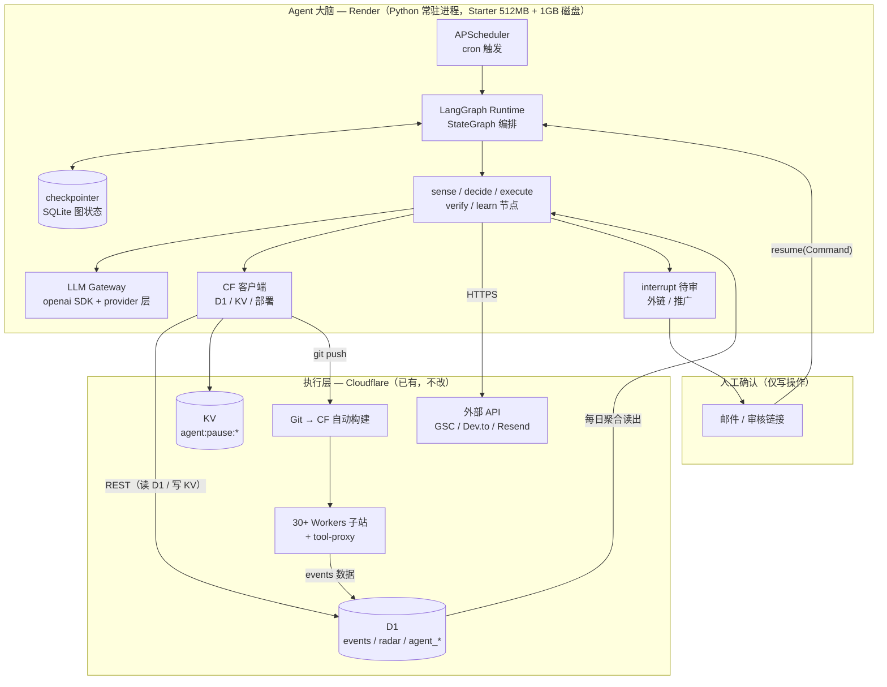
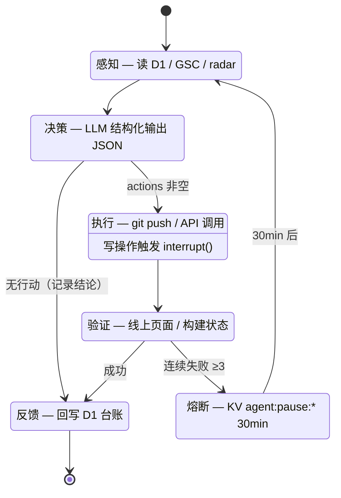
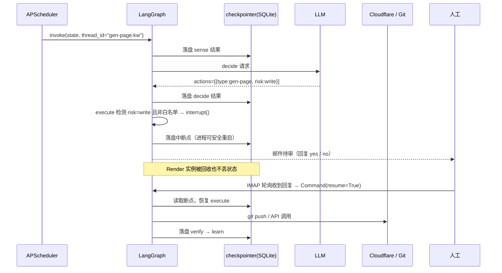
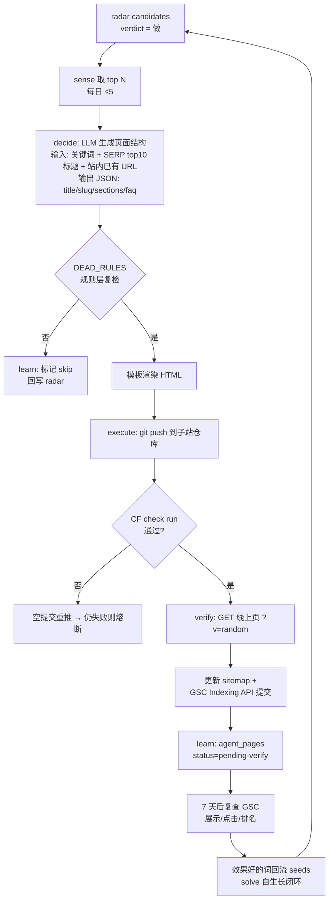
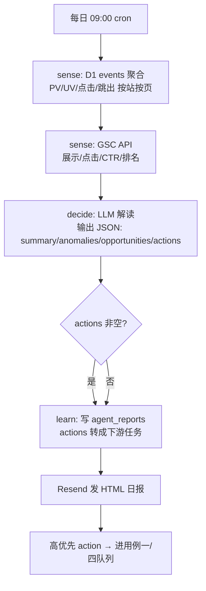
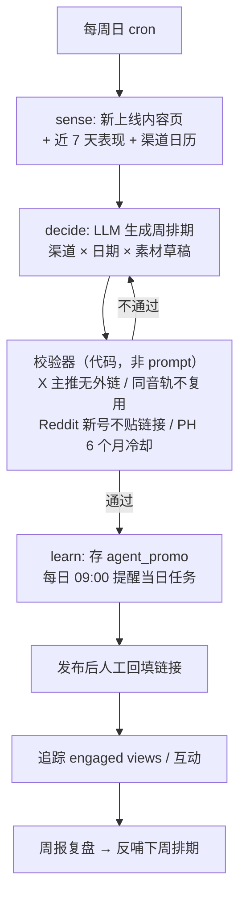

# Site-Agent 技术方案 — 基于 Render + LangGraph 的网站自动化运营智能体

> 版本：v1.1（2026-11-05）
> 变更：v1.0（Node.js）→ v1.1（Python + LangGraph）；取消 Playwright 强依赖（见附录 C）；删除自建任务队列表（改由 checkpointer 承担）。
> 定位：为 toolara.dev 站群（30+ Workers 子站）构建"感知 → 决策 → 执行 → 验证 → 反馈"闭环的自动化运营 Agent。
> 本文档与代码同仓库维护，代码结构见 §9。
> 授权：PolyForm Noncommercial License 1.0.0（可学习研究，禁止商用）· Copyright (c) 2026 lvyafei

---

## 目录

0. [快速开始](#0-快速开始骨架已就位)
1. [背景与目标](#1-背景与目标)
2. [总体架构](#2-总体架构)
3. [核心循环：LangGraph 状态图](#3-核心循环langgraph-状态图)
4. [四大用例设计与流程图](#4-四大用例设计与流程图)
5. [技术选型与实现细节](#5-技术选型与实现细节)
6. [数据模型](#6-数据模型)
7. [安全与风控](#7-安全与风控)
8. [实施步骤（分阶段）](#8-实施步骤分阶段)
9. [代码目录结构](#9-代码目录结构)
10. [成本估算](#10-成本估算)
11. [附录](#11-附录)

---

## 0. 快速开始（骨架已就位）

```bash
cd site-agent
uv sync                                  # 或 python -m venv .venv && pip install -e .
cp .env.example .env                     # 填 CF / GitHub / LLM / GSC / IMAP
python -m pytest -q test/test_validators.py   # 7 项红线与 slug 校验
python -m site_agent.main                # 启动调度器（本地先注释掉 cron 或改用手动触发）
```

手动触发一次任务（不依赖 cron）：

```bash
python -c "from site_agent.main import run_task; print(run_task('daily-report'))"
```

审批兜底（IMAP 不可用时）：

```bash
python -m site_agent.resume 'daily-report:2026-11-05' yes
```

---

## 1. 背景与目标

### 1.1 现状

| 已有资产 | 位置 | 说明 |
|---------|------|------|
| 30+ 子站 Workers | Cloudflare | 各站独立 git 仓库，push 后 CF 自动构建 |
| tool-proxy | Cloudflare | 唯一对外入口，service binding 转发，含 `/_ev` 埋点（D1 `events` 表） |
| google-trend-radar | Cloudflare | 热词/Suggest 采集、SERP 竞争度、趋势判定、candidates 打分 |
| D1 / KV / R2 | Cloudflare | events 埋点、配置、封面图 |
| Workers AI | Cloudflare | 账户级 10k neurons/天（额度紧张，不用于本 Agent） |

### 1.2 缺口

- **决策层缺失**：radar 能采集与打分，但 `verdict=做` 的词没有自动生成内容页的闭环（seeds 无自生长）。
- **数据无人解读**：D1 events 每天在收，但没有程序定期解读并转成行动。
- **推广与外链**：机会发现、素材准备、效果追踪全靠人工。

### 1.3 目标（四个自动化能力）

1. **热词 → 内容页**：radar 候选词自动生成 SEO 页并上线，回填收录效果（自生长闭环）
2. **数据解读**：每日聚合 D1 events + GSC，LLM 解读输出可执行建议
3. **外链机会发现**：自动监控机会、准备草稿，发布走人工确认
4. **推广素材与排期**：生成素材草稿、追踪表现、提醒发布窗口

### 1.4 设计红线

- ❌ 不直接向 Reddit / HN / X 发帖（ToS 封号风险，账号均为养号资产）
- ❌ 不做全自动外链群发（spam 判定风险）
- ✅ 读操作全自动；写操作进 `interrupt()` 人工审核或走白名单渠道（Dev.to API）
- ✅ LLM 全部走外部 API，不消耗 Workers AI 额度
- ✅ 全链路熔断：连续失败自动暂停，防止烧钱与刷屏

---

## 2. 总体架构

### 2.1 架构图



### 2.2 职责划分

| 层 | 位置 | 职责 | 为什么在这里 |
|----|------|------|-------------|
| 编排 | Render | cron、状态图、断点续跑、人审中断 | Workers 无长驻进程、无持久化图状态；Workers AI 额度仅 10k neurons/天 |
| 决策 | Render | LLM 调用（内容生成 / 解读 / 评分） | 外部 API，不占 CF 额度 |
| 执行 | Cloudflare | 站点服务、存储、构建发布 | 已有，不重复建设 |
| 确认 | 人 | 外链 / 社媒发布 | 平台封号风险不可自动化 |

### 2.3 与 CF 的两条连接线

1. **Cloudflare API Token**（D1 Edit + KV Edit）——数据与控制面
2. **git push**（GitHub 细粒度 PAT）——内容面：写 HTML 文件 → push 到子站仓库 → CF 构建自动上线，复用现有流水线，不引入新部署机制

---

## 3. 核心循环：LangGraph 状态图

### 3.1 五个节点



| 节点 | 职责 | 是否调 LLM |
|------|------|-----------|
| `sense` | 读 D1 events / GSC / radar candidates，组装 observations | 否 |
| `decide` | 唯一 LLM 调用点，输出结构化 `actions[]` | **是** |
| `execute` | 按 action 类型分发：git push / Dev.to API / 写 KV | 否 |
| `verify` | 线上页面 200 校验、check run 状态、API 返回码 | 否 |
| `learn` | 回写 `agent_pages` / `agent_backlinks` / `agent_reports` | 否 |

**纪律**：节点 = 纯 Python 函数，只有 `decide` 里出现 LLM。这样即使日后换掉 LangGraph，业务代码零改动。

### 3.2 断点续跑与人审时序



要点：

- **`thread_id` = 业务主键**（如 `gen-page:2026-11-05`），天然幂等：重复触发只续跑，不重复建页面
- **checkpointer 只存图状态**，业务台账仍写 D1（唯一真相源），避免两套数据打架
- **审批通道 = 邮件 + IMAP 轮询**：Background Worker 无公网入口，主动出站收信是零基础设施做法（见 §5.11）
- **熔断**：`verify` 失败累计 3 次 → 写 KV `agent:pause:<task_type>` + 邮件告警；30 分钟后 cron 自动重试（删键即恢复，代码不动）

---

## 4. 四大用例设计与流程图

### 4.1 用例一：热词 → 内容页（最高优先级）



技术细节：

- **生成 prompt 结构**：`关键词 + SERP top10 标题（radar serp.js 缓存）+ 站内已有页面 URL（防重复）+ 模板骨架`；输出 JSON 由代码渲染 HTML，**禁止 LLM 直出 HTML**（会破坏样式与埋点）
- **双保险判死**：LLM 生成后再跑一遍 radar 的规则（真人姓名 / 作品名 / 纯资讯）
- **git 部署**：`subprocess` 调 git；push 后轮询 GitHub check run `Workers Builds: <服务名>`，30 分钟未见 → `commit --allow-empty` 重推（沿用 30+ 仓库齐推排队的经验）；上线判定只看线上页面
- **限额**：每日 ≤5 页（新站首月 ≤3/天），LLM 成本与"内容突增"风险双控

### 4.2 用例二：数据解读日报（MVP 第一周，零风险）



技术细节：

- **D1 聚合口径**：按天分组沿用现有 `CAST(ts/86400000 AS INTEGER)*86400000`；列名以 tool-proxy `src/index.js` 实际 schema 为准（代码里集中在 `src/site_agent/tasks/daily_report.py` 一处）
- **输出必须结构化**：先 JSON 再渲染邮件，禁止 LLM 输出长文（不可机读、不可回填任务）
- **行动闭环**：`actions[].type ∈ {content-fix, new-page, promo}` 自动落成下游任务记录，这是"数据 → 行动"的关键一跳

### 4.3 用例三：外链机会发现（半自动）

```mermaid
flowchart TB
    A[每周 3 次 cron] --> B[sense: 机会源<br/>Reddit search.json / Dev.to 标签 / 竞品外链]
    B --> C[decide: LLM 评分<br/>相关度×0.6 + 渠道权重×0.4]
    C --> D{score ≥ 0.7?}
    D -- 否 --> E[learn: 降权留档]
    D -- 是 --> F[生成投放草稿<br/>文案 + 目标 URL + 渠道]
    F --> G[execute: interrupt()<br/>邮件推人工审核]
    G --> H{人工确认?}
    H -- 否 --> E
    H -- 是 --> I[Dev.to: API 全自动<br/>其余: 复制草稿由人发]
    I --> J[learn: agent_backlinks<br/>30 天后存活复查]
```

技术细节：

- **渠道权重**：Dev.to 1.0（API 可自动化）/ Reddit 0.8（需人工）/ 目录站 0.5（已封盘，仅记录）
- **Reddit 只读**：用 `https://www.reddit.com/search.json?q=...` 公共接口，无需登录、不触发 ToS 发帖风险
- **存活复查**：30 天后 `requests.get(source_url)` + 正则查目标域名，失效标记 `status=dead`

### 4.4 用例四：推广素材与排期（半自动）



技术细节：

- **红线写进校验器**（`src/site_agent/tasks/promo/validators.py`），不是写进 prompt——prompt 是概率性的，校验器是确定性的
- 表现数据：YouTube Data API（免费 10k units/天）；X / Reddit 人工回填

---

## 5. 技术选型与实现细节

### 5.1 技术栈

| 组件 | 选型 | 理由 |
|------|------|------|
| 语言 / 运行时 | Python 3.11 + uv | 生态成熟；3.11 内存优于 3.12 |
| 编排 | **LangGraph**（`StateGraph` + `interrupt` + checkpointer） | 显式状态图 = 五段循环；`interrupt()` 原生人审；checkpointer 断点续跑 |
| 持久化 | `langgraph-checkpoint-sqlite` | 免起 DB 服务，512MB 实例可跑 |
| 调度 | APScheduler（进程内） | 免额外服务；也可换 Render Cron Job |
| LLM | `openai` SDK（OpenAI 兼容端点） | 不用 langchain 全家桶（见 5.2） |
| HTTP | `requests` | 足够，不引 httpx 双栈 |
| GSC | `google-api-python-client` + 服务账号 | 官方 API，替代浏览器抓取 |
| 邮件 | Resend REST（`requests` 直调） | 无需 SDK |
| 部署 | Render Background Worker | Starter $7/月：512MB + 1GB 持久盘（免费实例磁盘是临时的，会丢 checkpointer，不能用于 interrupt 流程） |

**依赖白名单（只装这些，多一个都不加）**

```
langgraph
langgraph-checkpoint-sqlite
openai
requests
apscheduler
google-api-python-client
google-auth
```

> 明确不装：`langchain`（全家桶）、`langchain-community`、`playwright`（见附录 C）、`celery`、`redis`、`sqlalchemy`。

### 5.2 三条工程纪律

1. **不碰 LangChain 抽象层**：不用 `Document` / `Chain` / `Retriever` / `AgentExecutor`。只用 `StateGraph` + `interrupt` + checkpointer 三件。LLM 直接用 `openai` SDK。
2. **节点是纯函数**：所有 IO（D1、git、HTTP）在 `src/site_agent/cf/` 与 `tasks/` 里，节点只做编排。换框架时业务零改动。
3. **锁版本**：`uv.lock` 提交进仓库，升级手动做并跑 `pytest`。LangGraph 迭代快，不锁必炸。

### 5.3 内存与磁盘预算（Render Starter：512MB / 1GB 盘）

| 项 | 估算 |
|---|---|
| Python 解释器 + langgraph + openai + requests | ≈ 180-220MB |
| APScheduler + google-api-client（按需 import） | ≈ 40MB |
| 工作内存（D1 结果集、HTML 渲染、git clone） | ≈ 50-100MB |
| **合计** | **≈ 280-360MB，安全** |

**关键约束一**：不装 Playwright。Chromium 单独就要 300-400MB，加上去必 OOM（详见附录 C）。

**关键约束二**：checkpointer 必须落在**持久盘**上。Render 免费实例的文件系统随实例销毁而清空，重启后所有未完成的 interrupt 全部丢失，人审流程会静默失效。两个选择：

| 方案 | 成本 | 说明 |
|------|------|------|
| Starter + 1GB disk（本文档默认） | $7/月 | `render.yaml` 里 `disk.mountPath=/data`，`AGENT_STATE_DIR=/data` |
| Neon 免费 Postgres + `langgraph-checkpoint-postgres` | $0 | 换一行 connector，适合想先零成本验证的阶段 |

此外 git 仓库 clone 也落在 `/data/repos`，重启后不必重新拉取。

### 5.4 状态定义

```python
# src/site_agent/state.py
from typing import Any, Literal, TypedDict

TaskType = Literal["gen-page", "daily-report", "backlink", "promo"]


class Action(TypedDict, total=False):
    type: str        # gen-page / devto-publish / content-fix / promo-draft
    risk: str        # "read" | "write"
    auto: bool       # True = 白名单渠道免 interrupt（当前仅 Dev.to）
    key: str         # 幂等键
    payload: dict[str, Any]
    summary: str     # 人审邮件里展示的一句话


class OpsState(TypedDict, total=False):
    task_type: TaskType
    payload: dict[str, Any]
    observations: list[dict[str, Any]]
    actions: list[Action]
    executed: list[dict[str, Any]]
    result: dict[str, Any] | None
    errors: list[str]
    retry: int
```

### 5.5 图组装

```python
# src/site_agent/graph.py
import sqlite3
from langgraph.graph import StateGraph, START, END
from langgraph.checkpoint.sqlite import SqliteSaver

from .state import OpsState
from .nodes.sense import sense
from .nodes.decide import decide
from .nodes.execute import execute
from .nodes.verify import verify
from .nodes.learn import learn


def route_after_decide(state: OpsState) -> str:
    return "execute" if state.get("actions") else "learn"


def build_graph() -> StateGraph:
    g = StateGraph(OpsState)
    g.add_node("sense", sense)
    g.add_node("decide", decide)
    g.add_node("execute", execute)
    g.add_node("verify", verify)
    g.add_node("learn", learn)

    g.add_edge(START, "sense")
    g.add_edge("sense", "decide")
    g.add_conditional_edges("decide", route_after_decide,
                            {"execute": "execute", "learn": "learn"})
    g.add_edge("execute", "verify")
    g.add_edge("verify", "learn")
    g.add_edge("learn", END)
    return g


def compile_app(checkpoint_path: str = "data/agent.sqlite"):
    conn = sqlite3.connect(checkpoint_path, check_same_thread=False)
    return build_graph().compile(checkpointer=SqliteSaver(conn))
```

### 5.6 人审中断（execute 节点）

```python
# src/site_agent/nodes/execute.py（核心片段，实现见仓库）
from langgraph.types import interrupt

DONE_STATES = {"deployed", "published", "scheduled", "ready-to-post", "skipped", "rejected"}


def execute(state):
    executed = list(state.get("executed") or [])
    done = {e["key"] for e in executed if e.get("status") in DONE_STATES}
    for action in state.get("actions") or []:
        if action["key"] in done:
            continue
        # risk=write 且非白名单渠道 → 挂起等人（Dev.to 带 auto=True 直接执行）
        if action.get("risk") == "write" and not action.get("auto"):
            _notify_once(thread_id, action)     # KV 标记，resume 重跑时不会重复发信
            approved = interrupt({"key": action["key"], "summary": action["summary"]})
            if not approved:
                executed.append({"key": action["key"], "status": "rejected"})
                continue
        executed.append(mod.execute_action(action))
    return {"executed": executed}
```

两个必须知道的行为：

1. **resume 会从头重跑整个节点**，所以 `execute_action` 必须幂等（`gen_page` 查 D1、`promo` 查当日排期、`backlink` 以 key 判重），否则会重复建页。
2. **审批邮件用 KV 标记 `approval-sent:<key>` 只发一次**，否则每次 resume 都会重发。

恢复执行（IMAP 收到 yes 后）：

```python
app.invoke(Command(resume=True), config={"configurable": {"thread_id": tid}})
```

### 5.7 D1 客户端

```python
# src/site_agent/cf/d1.py
import os
import requests

CF_API = "https://api.cloudflare.com/client/v4"


def query(sql: str, params: list | None = None) -> list[dict]:
    url = (f"{CF_API}/accounts/{os.environ['CF_ACCOUNT_ID']}"
           f"/d1/database/{os.environ['D1_DATABASE_ID']}/query")
    r = requests.post(
        url,
        headers={"Authorization": f"Bearer {os.environ['CF_API_TOKEN']}"},
        json={"sql": sql, "params": params or []},
        timeout=30,
    )
    body = r.json()
    if not body.get("success"):
        raise RuntimeError(f"D1 error: {body.get('errors')}")
    return body["result"][0]["results"]
```

### 5.8 LLM 网关（按任务配置 + 熔断）

```python
# src/site_agent/llm/gateway.py
import json
from openai import OpenAI
from .breaker import record, ensure_alive

_client = OpenAI(
    base_url=os.environ.get("LLM_BASE_URL"),
    api_key=os.environ["LLM_API_KEY"],
)

PROFILES = {
    "content-gen":   {"model": "gpt-4o-mini", "temperature": 0.7, "max_tokens": 4000},
    "data-report":   {"model": "gpt-4o-mini", "temperature": 0.2, "max_tokens": 2000},
    "backlink-score": {"model": "gpt-4o-mini", "temperature": 0.3, "max_tokens": 800},
}


def json_call(task: str, system: str, user: str, retries: int = 2) -> dict:
    ensure_alive("llm")
    cfg = PROFILES[task]
    for attempt in range(retries + 1):
        try:
            resp = _client.chat.completions.create(
                messages=[{"role": "system", "content": system},
                          {"role": "user", "content": user}],
                response_format={"type": "json_object"},
                **cfg,
            )
            _usage(resp.usage)              # 累计 token 用量，日报里展示成本
            return json.loads(resp.choices[0].message.content)
        except Exception as exc:
            record("llm", ok=False, error=str(exc))
            if attempt == retries:
                raise
    raise RuntimeError("unreachable")
```

### 5.9 部署链路（git push + check run）

```python
# src/site_agent/cf/deploy.py（核心逻辑）
def deploy_page(site: SiteConfig, page: GeneratedPage) -> bool:
    workdir = clone_or_pull(site)                       # subprocess git
    write_page(workdir, page)                           # 写 public/<slug>.html
    git(workdir, "add", "-A")
    git(workdir, "commit", "-m", f"add: {page.slug}")
    git(workdir, "push", "origin", site.branch)

    if not wait_check_run(site, "Workers Builds", timeout=6 * 60):
        git(workdir, "commit", "--allow-empty", "-m", "ci: retrigger")
        git(workdir, "push", "origin", site.branch)
        if not wait_check_run(site, "Workers Builds", timeout=6 * 60):
            return False

    # 上线只认线上页面（穿透缓存）
    r = requests.get(f"https://{site.host}/{page.slug}.html?v={int(time.time())}",
                     timeout=20)
    return r.status_code == 200 and page.title in r.text
```

### 5.10 配置（环境变量）

```bash
CF_ACCOUNT_ID=
CF_API_TOKEN=              # D1 Edit + Workers KV Edit
D1_DATABASE_ID=
GITHUB_TOKEN=              # 细粒度 PAT，仅指定子站仓库，contents: write
GSC_SA_JSON=               # 服务账号 JSON 单行
GSC_PROPERTY=sc-domain:toolara.dev
LLM_API_KEY=
LLM_BASE_URL=              # 兼容端点，可留空走官方
RESEND_API_KEY=
ADMIN_EMAIL=
IMAP_HOST=imap.gmail.com   # 审批回复轮询
IMAP_USER=
IMAP_PASS=                 # 应用专用密码，非登录密码
TZ=Asia/Shanghai
```

### 5.11 人工审批通道（零公网入口）

Background Worker 没有对外 URL，所以不能用"点链接确认"。做法是**主动出站收信**：

```
execute 挂起 → Resend 发信主题 [site-agent] 待确认：<thread_id>
              ↓ 人回复 yes / no
APScheduler 每 5 分钟 → IMAP search UNSEEN SUBJECT "site-agent"
              ↓ 解析主题里的 thread_id + 正文第一段的 yes/no（剔除引用段）
Command(resume=True/False) → 图从断点继续
```

要点：

- **只看正文第一段**：用 `\n>` / `On ... wrote:` 切掉引用原文，避免把邮件原始内容里的 "yes" 误判
- **未给明确结论就保持未读**，不会误消费
- **兜底 CLI**：`uv run site-agent-approve <thread_id> yes`（调试或 IMAP 不可用时）
- Gmail 需开两步验证并生成应用专用密码；企业邮箱同理

---

## 6. 数据模型

### 6.1 变更说明（相对 v1.0）

**删除** 自建的 `tasks` 队列表——由 LangGraph checkpointer 承担状态持久化（`thread_id` = 业务主键，天然幂等、可恢复）。

**保留** D1 三张业务台账表（唯一真相源，与 events 同库便于 join）。

### 6.2 D1 表结构

```sql
-- 内容页台账
CREATE TABLE IF NOT EXISTS agent_pages (
  id INTEGER PRIMARY KEY AUTOINCREMENT,
  site TEXT NOT NULL,
  keyword TEXT NOT NULL,
  slug TEXT NOT NULL,
  status TEXT NOT NULL DEFAULT 'generated',  -- generated/deployed/indexed/verified/failed
  gsc_clicks INTEGER DEFAULT 0,
  gsc_impressions INTEGER DEFAULT 0,
  avg_position REAL,
  created_at INTEGER NOT NULL,
  verified_at INTEGER,
  UNIQUE(site, slug)
);

-- 外链台账
CREATE TABLE IF NOT EXISTS agent_backlinks (
  id INTEGER PRIMARY KEY AUTOINCREMENT,
  channel TEXT NOT NULL,          -- devto / reddit / directory
  target_url TEXT NOT NULL,
  source_url TEXT,
  anchor_text TEXT,
  status TEXT NOT NULL DEFAULT 'draft',   -- draft/approved/published/dead
  score REAL,
  created_at INTEGER NOT NULL,
  checked_at INTEGER
);

-- 日报与周报（同一日期下 daily / plan 可共存，故联合唯一）
CREATE TABLE IF NOT EXISTS agent_reports (
  id INTEGER PRIMARY KEY AUTOINCREMENT,
  report_date TEXT NOT NULL,              -- YYYY-MM-DD
  kind TEXT NOT NULL DEFAULT 'daily',     -- daily / weekly / plan
  summary TEXT,
  anomalies TEXT,                         -- JSON
  actions TEXT,                           -- JSON
  created_at INTEGER NOT NULL,
  UNIQUE(report_date, kind)
);
```

### 6.3 checkpointer 表

`langgraph-checkpoint-sqlite` 自动建表（`checkpoints` / `writes`），**不要手工改**。它只存图状态，业务查询一律走 D1。

---

## 7. 安全与风控

| 风险 | 措施 |
|------|------|
| LLM 生成低质/重复内容 | 每日 ≤5 页；DEAD_RULES 规则层复检；站内 URL 查重；前 20 页人工抽查建基线 |
| API Token 泄漏 | 细粒度权限（仅 D1 Edit + KV Edit）；Render 环境变量不落盘；PAT 仅限仓库、`contents: write` |
| 部署故障扩散 | 单任务失败不影响其他；同类型连续 3 次失败 → 熔断 30 分钟 + 邮件 |
| 平台封号（Reddit/HN/X） | 硬编码：这三类渠道永不直接发帖，只产出草稿进 interrupt 待审 |
| LLM 成本失控 | 每任务记 token；日报/评分用 mini 级；每日调用上限 100 次（超限写 KV 暂停） |
| 数据误删 | Agent 对 D1 只 INSERT / 有限 UPDATE，无 DELETE；KV 只写 `agent:` 前缀 |
| 实例重启丢状态 | checkpointer 落盘；`thread_id` 幂等，重启后 cron 自动续跑 |
| 新站内容突增被惩罚 | 新站首月 ≤3 页/天，站点节奏均匀 |

---

## 8. 实施步骤（分阶段）

### 阶段 0：基建（1-2 天）

- [ ] `uv sync` 装依赖白名单，`uv.lock` 提交（骨架代码已就位，直接跑 `pytest`）
- [ ] 创建 CF API Token（D1 Edit + KV Edit）、GitHub 细粒度 PAT、GSC 服务账号
- [ ] 取件：`D1_DATABASE_ID`、`KV_NAMESPACE_ID`、`RADAR_USER/PASS`、`DEVTO_API_KEY`
- [ ] Gmail 开两步验证 → 生成 IMAP 应用专用密码（审批通道，§5.11）
- [ ] D1 执行 `migrations/0001_agent_tables.sql`
- [ ] `render.yaml` 建 Background Worker（Starter + 1GB disk），连仓库自动部署
- [ ] 跑通最小链路：`python -m site_agent.main` 启动 → 手动触发 `daily-report` → 看日志与 KV

> 骨架已包含：图组装、五个节点、四个任务模块、D1/KV/git/LLM/邮件客户端、模板、单测。
> 待补的是真实 schema 对齐（events 列名）、站点映射与你自己的 prompt 调优。

### 阶段 1：数据解读日报（第 1 周，MVP）

- [ ] `tasks/daily_report.py`：D1 聚合（按天/站/页）+ GSC 拉取
- [ ] `decide` 接 LLM，输出 JSON → 渲染 HTML → Resend 发信
- [ ] 报告落 `agent_reports`
- [ ] **验收**：连续 3 天收到日报，建议可读、可执行

### 阶段 2：热词 → 内容页闭环（第 2 周）

- [ ] 读 radar candidates + 每日 top N 选取
- [ ] 内容生成（JSON → 模板渲染）+ DEAD_RULES 复检
- [ ] git push + check run 轮询 + 线上验证（§5.9）
- [ ] sitemap 更新 + GSC Indexing API 提交
- [ ] 7 天后 GSC 回流写 `agent_pages`，好词回流 seeds
- [ ] **验收**：全自动上线 ≥5 页，线上 200，GSC 收录 ≥2

### 阶段 3：外链机会发现（第 3 周）

- [ ] Reddit `search.json` / Dev.to 标签 / 竞品外链采集
- [ ] LLM 评分 + 草稿 + `interrupt()` 待审邮件
- [ ] Dev.to API 全自动通道
- [ ] `agent_backlinks` 台账 + 30 天存活复查
- [ ] **验收**：每周 ≥5 条 score ≥0.7 草稿，Dev.to 链路自动化跑通

### 阶段 4：推广排期（第 4 周）

- [ ] 周排期生成 + 渠道日历
- [ ] 红线校验器（X 无外链等）单独单测
- [ ] YouTube Data API 表现追踪
- [ ] 周报复盘反哺策略
- [ ] **验收**：产出下周排期且全部通过校验器

### 阶段 5：闭环打磨（持续）

- [ ] 日报 action 自动转下游任务（用例二 → 一/四联动）
- [ ] radar 自生长效果对比（回流 seeds 前后候选池质量）
- [ ] 成本报表（tokens / 调用次数 / 单页成本）

---

## 9. 代码目录结构

```
site-agent/
├── docs/
│   └── tech-design.md
├── src/site_agent/
│   ├── __init__.py
│   ├── config.py            # 环境变量 + SITES 映射（site → repo/host/模板）
│   ├── main.py              # APScheduler 启动 + 5 个 cron
│   ├── approvals.py         # IMAP 轮询审批回复
│   ├── resume.py            # Command(resume) 封装 + CLI 兜底
│   ├── state.py             # OpsState / Action TypedDict
│   ├── graph.py             # StateGraph 组装 + 编译（checkpointer）
│   ├── nodes/
│   │   ├── sense.py         # 熔断检查 + 分发到 tasks/*.sense
│   │   ├── decide.py        # 唯一 LLM 调用点
│   │   ├── execute.py       # interrupt + 幂等去重 + 动作分发
│   │   ├── verify.py        # 校验结果，失败计入熔断
│   │   └── learn.py         # 写 D1 台账
│   ├── cf/
│   │   ├── d1.py            # D1 HTTP API（禁 DELETE）
│   │   ├── kv.py            # KV 读写（agent: 前缀）
│   │   └── deploy.py        # 渲染 + git push + check run + 线上验证
│   ├── llm/
│   │   ├── gateway.py       # json_call + 用量计数
│   │   ├── breaker.py       # 熔断
│   │   └── prompts/         # gen_page / daily_report / backlink / promo
│   ├── collectors/
│   │   ├── gsc.py           # Search Console 官方 API + Indexing
│   │   ├── reddit.py        # search.json 只读
│   │   └── radar.py         # 读 radar /api/candidates
│   ├── tasks/
│   │   ├── __init__.py      # 注册表 get_task()
│   │   ├── gen_page.py      # 用例一
│   │   ├── daily_report.py  # 用例二 + 7 天效果回流
│   │   ├── backlink.py      # 用例三
│   │   └── promo.py         # 用例四（validate() 即红线校验器）
│   └── notify/
│       └── mail.py          # Resend：日报 / 告警 / 审批
├── templates/site-page.html # 内容页模板（{{token}} 占位）
├── migrations/0001_agent_tables.sql
├── test/test_validators.py  # 红线与 slug 纯函数单测（7 项，已通过）
├── pyproject.toml
├── render.yaml
└── .env.example
```

---

## 10. 成本估算

| 项目 | 费用 | 说明 |
|------|------|------|
| Render Background Worker | **$7/月** | Starter：512MB + 1GB 持久盘（免费实例磁盘临时，checkpointer 会丢，见 §5.3） |
| Cloudflare D1 / KV / API | $0 | 现有额度内 |
| GSC API / Indexing API | $0 | 免费（Indexing 200 次/天） |
| LLM（mini 级） | ≈ $3-8/月 | 日报 1 次/天 + 内容 5 页/天 + 评分 15 次/周 |
| Resend 邮件 | $0 | 免费 100 封/天 |
| Dev.to / Reddit / YouTube API | $0 | 免费额度 |
| **合计** | **≈ $10-15/月** | 想先零成本验证：Render 免费 + Neon 免费 Postgres 做 checkpointer（$0，见 §5.3） |

---

## 11. 附录

### 附录 A：与现有系统的边界

- **不改** tool-proxy 路由/埋点逻辑（Agent 只通过 API 读写数据）
- **不改** radar 采集 cron（Agent 只读 candidates 产出）
- KV 键统一 `agent:` 前缀，避免与 `RADAR` / `autopilot:pause` 冲突
- radar 的账户额度哨兵职责不变；本 Agent 的 LLM 全走外部 API

### 附录 B：红线规则速查（硬编码进校验器）

1. Reddit / HN / X —— 永不直接发帖，只产出草稿
2. 外链 —— 永不全自动群发，发布前人工确认（Dev.to 文章除外）
3. HN 发布 —— 固定 2026-11-04 21:00 (UTC+8) 手动执行，Agent 只提醒
4. X 主推 —— 永不含外链，演示视频原生上传
5. 新内容页 —— 每日 ≤5，新站首月 ≤3/天
6. 禁止生成真人姓名 / 他人作品名 / 纯资讯类页面（DEAD_RULES）

### 附录 C：为什么不用 Playwright（以及何时引入）

v1.0 方案用 Playwright 抓 GSC 和平台页面，v1.1 取消，原因：

1. **内存**：Chromium 300-400MB，512MB 免费实例必 OOM
2. **可替代**：GSC 有官方 API；Reddit 有 `search.json` 只读接口；SERP 数据 radar 已落库
3. **稳定性**：真浏览器采集脆弱（登录态过期、反爬改版），维护成本高

**引入条件**（满足其一才考虑）：

- 需要检查"目录站是否收录/外链是否存活"且 HTTP + 正则无法判定
- 需要读取必须登录才可见的平台数据

引入方式：拆独立 Render Starter 服务（$7/月）跑 `playwright`，暴露内部 HTTP 接口，编排层调用；**不把 Playwright 装进主进程**。
